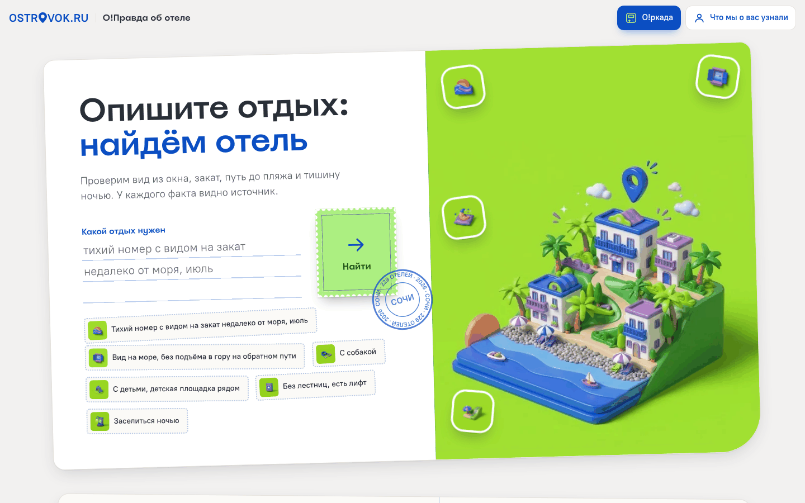
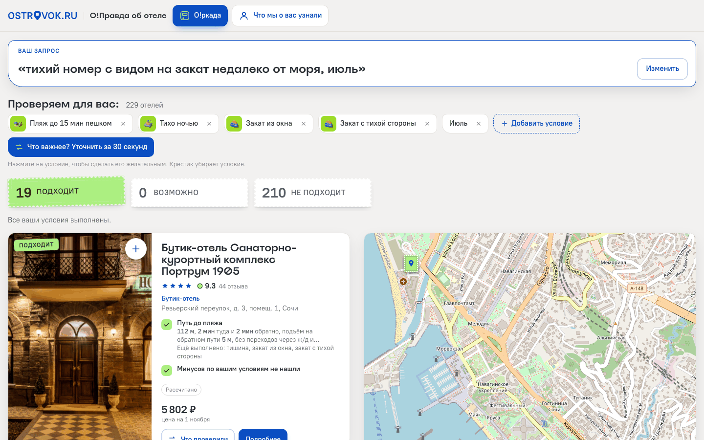
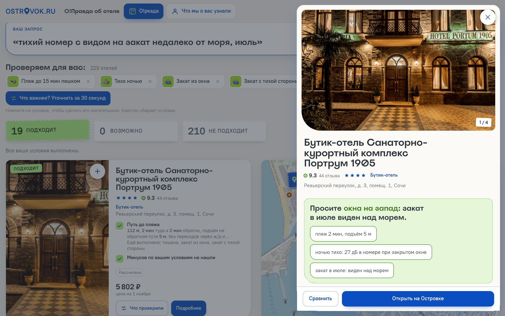
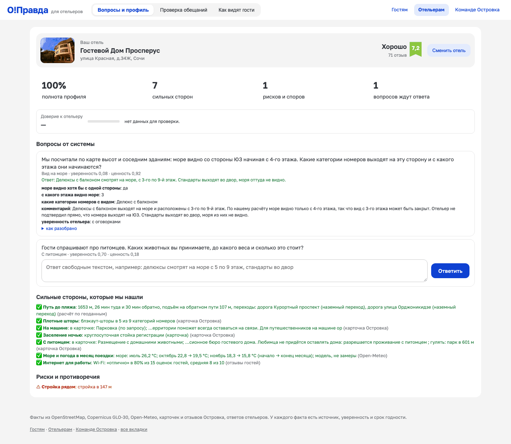
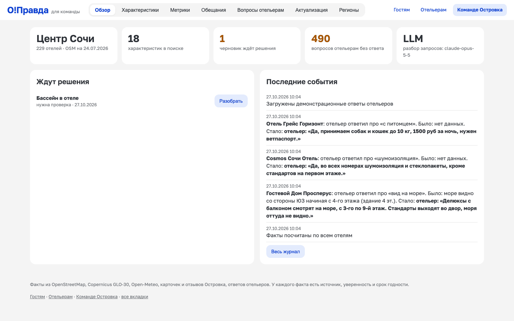
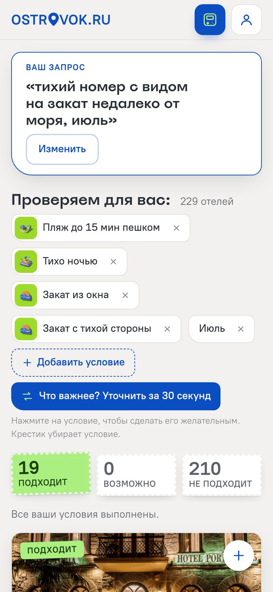
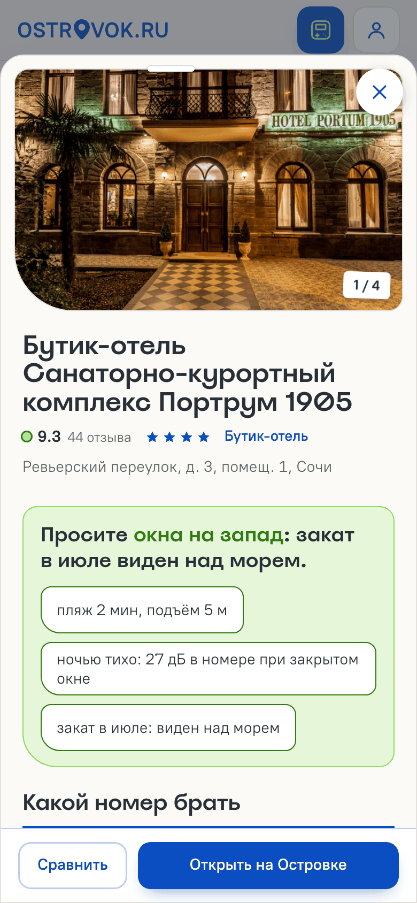
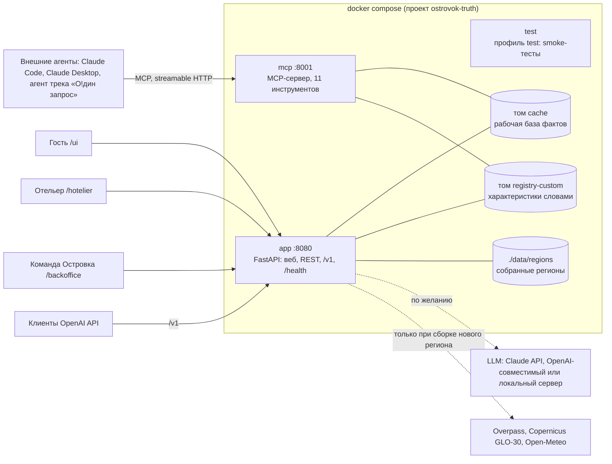

# О!Правда об отеле (трек «О!дин шаг до идеального отеля»)

Проверяем по открытым данным то, чего нет в карточке отеля (вид на море по этажам, путь до пляжа, шум ночью), с источником у каждого факта, и отвечаем на запрос гостя словами: какой отель, какой номер брать и что попросить при брони.

- Видео-скринкаст: ссылка на публичный хостинг будет добавлена; копия в репозитории: [docs/demo.mp4](docs/demo.mp4) (3,5 минуты)
- Развёрнутый сервис: нет, запуск локально одной командой (ниже)

Прототип для трека «О!дин шаг до идеального отеля» (хакатон Островка, октябрь 2026). Три региона: центр Сочи (229 отелей, по умолчанию), Адлер (339) и Хоста (22).

**Мы проверяем детали отеля, которые важны именно для вашей поездки.** В центре три вещи: видно ли море из номера, который вам дадут, сколько на самом деле идти до пляжа и где слова отеля расходятся с расчётом и отзывами.

**Для жюри.** Презентация: [docs/deck/deck.pdf](docs/deck/deck.pdf) (8 слайдов, исходник `docs/deck/deck.html`). Видео-демо 3,5 минуты: [docs/demo.mp4](docs/demo.mp4) (запрос → три варианта → неожиданная деталь с доказательством → спорное заявление → ответ отельера → характеристика, одобренная админом; пересъёмка `python scripts/record_demo.py`). Запуск: `docker compose up --build`, ключ LLM не нужен, демо-вход админа и отельера с паролем `demo`. Точность вида на море: [docs/accuracy.md](docs/accuracy.md).

Система вычисляет то, чего нет в карточке отеля: видно ли море и с какого этажа, виден ли закат в нужный месяц, сколько идти до пляжа и придётся ли подниматься в гору, где тихо ночью. Каждый факт хранится с источником, уверенностью и датой, а противоречия между источниками видны. Отельеру система задаёт вопросы только по существу. Ищет по запросу словами, объясняет, почему отель подходит и в чём не дотягивает, и говорит, какой номер брать и что попросить при брони.

**Главный принцип: LLM не угадывает факты.** Она разбирает запрос, пишет рецепты характеристик и раскладывает ответы отельера по полям. Все числа считает детерминированный код по открытым данным, а ответ чата проверяется по выводам инструментов. Единственное место, где модель сама даёт наблюдение, это метки фото: Claude смотрит на кадры из карточки. Это отдельный источник со своим весом и подписью «фото отеля». Для вида на море он даёт только положительный факт, а для штор и ступенек идёт слабой уликой ниже порога спора (см. [«Фото как независимый датчик»](#фото-как-независимый-датчик)).

**Содержание**

- [Как закрыты требования кейса](#как-закрыты-требования-кейса) · [Как это выглядит](#как-это-выглядит) · [Запуск за 5 минут](#запуск-за-5-минут) · [Три интерфейса по ролям](#три-интерфейса-по-ролям) · [Роли и доступ](#роли-и-доступ) · [Что попробовать](#что-попробовать)
- [Архитектура](#архитектура) · [Развёртывание в Docker](#развёртывание-в-docker) · [Технологии](#технологии)
- [Возможности](#возможности): характеристики, поиск, развилки, вердикт, номера, вид из окна, ночь по часам, движок правды, фото, радар, проверка ответов, черновики, регионы, профиль города, расчёты map-app, OpenAI API, MCP, О!ркада, кластеры вкуса
- [Уверенность и метрики](#уверенность-и-метрики) · [Замеры](#замеры-до-и-после) · [Данные](#данные-и-их-происхождение) · [API](#api)
- [Путь в прод: на чём это может работать](#путь-в-прод-на-чём-это-может-работать) · [Ограничения прототипа](#ограничения-прототипа) · [Команда и документы](#команда-и-документы)

## Как закрыты требования кейса

Каждая строка ведёт в код и в место интерфейса, где это видно. ✅ значит сделано полностью, ◐ сделано частично: чего нет, сказано прямо в строке.

### Ожидаемый результат

| Требование | | Как сделано | Где посмотреть |
|---|---|---|---|
| Работающий прототип для отелей выбранного региона, поиск по собранным характеристикам | ✅ | Центр Сочи: 229 средств размещения, 33 характеристики, 6 999 фактов | `/ui`, запрос «тихий номер с видом на закат недалеко от моря, июль» |
| Один регион, проработанный глубоко | ✅ | Основной регион один, центр Сочи. Адлер и Хоста собраны тем же конвейером только чтобы показать, что код не привязан к городу | [«Новый регион одной командой»](#новый-регион-одной-командой) |
| Запуск по инструкции из README | ✅ | Одна команда `docker compose up --build`, без `.env` тоже. Около 1,5 минуты с нуля | [«Запуск за 5 минут»](#запуск-за-5-минут) |
| Без многочасовой загрузки, демо-данные в репозитории | ✅ | Предрасчёт фактов, вырезка OSM, карта высот, климат и отели лежат в `data/` (около 65 МБ). При старте ничего не скачивается | [«Данные и их происхождение»](#данные-и-их-происхождение) |
| Если нужен ключ LLM, описать в README и приложить `.env.example` | ✅ | Ключ необязателен. Провайдеры (Claude API, OpenAI-совместимые и локальные модели, Claude Code по подписке) описаны ниже и в `.env.example` | [«Запуск за 5 минут»](#запуск-за-5-минут), `.env.example` |

### Основные задачи

| Задача | | Как сделано | Где посмотреть |
|---|---|---|---|
| Сбор характеристик: агент сам решает, какие источники и инструменты нужны | ✅ | У каждой характеристики в `registry/*.yaml` методы из разных источников: геоданные, OSM, карточка, отзывы, фото, Open-Meteo. Для новой характеристики `app/compiler.py` по описанию словами выбирает инструменты из каталога `app/tools/catalog.py`, видя реальный список тегов OSM в зоне. Рецепт проверяется на 5 отелях, при ошибке LLM его исправляет | Вкладка «Характеристики» |
| Хотя бы одна характеристика вычисляется по геоданным | ✅ | По геоданным считаются 14 характеристик. Вид на море и закат (`app/tools/view.py`): лучи по карте высот Copernicus GLO-30 и зданиям OSM по сторонам здания и этажам, 24 прогона Монте-Карло по неточным высотам. Путь до пляжа (`app/tools/walk.py`): пеший граф OSM, рельеф, функция Тоблера, переходы через ж/д и дороги. Шум по сторонам здания (`app/tools/noise.py`) | Карточка отеля: «море видно со стороны ЮЗ с 4-го этажа», маршрут на карте, блоки «Вид из окна» и «Ночь по часам» |
| Диалог с отельером: вопрос, ответ свободным текстом, раскладка по полям | ✅ | `registry.plan_questions` ставит вопросы там, где данных нет или источники спорят, по ценности информации, не больше 3 на отель. `app/hotelier.py` раскладывает ответ по полям (LLM или правила) и показывает эхо «Мы поняли так: … Верно?». Фактом с источником «отельер» ответ становится только после «да». Отельер имитируется: в демо три ответа уже даны (`scripts/seed_demo.py`), остальные можно дать в кабинете | `/hotelier`, отель «Просперус» |
| У каждого значения источник, уверенность и дата | ✅ | `app/store.py`: факт = значение + источник + метод + уверенность + дата получения + срок годности + улики. Старые версии уходят в историю | Таблица «что знаем и откуда» в карточке отеля |
| Противоречия между источниками: система замечает и разбирается | ✅ | Движок правды `app/truth.py` (EM в духе Dawid–Skene) оценивает надёжность каждого источника с учётом класса характеристики: физика, решение отеля или опыт гостей. Спор помечается ⚠, рядом сказано, кому поверили и почему. У отельера есть репутация. По спорному факту уходит вопрос отельеру | «Все источники» в карточке отеля, вкладка «Проверка обещаний», [«Движок правды»](#движок-правды-кому-верить) |
| Расширяемость: новая характеристика описанием текстом | ✅ | Характеристика — это YAML-файл с описанием и рецептом, код не меняется. Описание словами превращается в рецепт (`app/compiler.py`, без ключа LLM по шаблонам). Черновик видит только автор, пока админ его не одобрит | «Характеристики» → «Новая характеристика словами», [«Черновики»](#черновики-админ-одобряет-то-что-собрал-агент) |
| Поиск по запросу своими словами | ✅ | `app/search.py`: LLM или правила разбирают запрос в условия по полям реестра. Отели раскладываются на «подходит», «возможно, уточняем», «не подходит». Чего реестр не покрывает, возвращается в `missing` с кнопкой «собрать» | `/ui`, чат в `/ui/classic` |

### Дополнительные задачи

| Задача | | Как сделано | Где посмотреть |
|---|---|---|---|
| Объяснение выбора | ✅ | По каждому условию ✅ / ✖ / ❓ с источником и уверенностью. Вердикт «какой номер брать» со стороной и этажом. Если подходящих мало, система говорит, какое условие ослабить | [«Вердикт в карточке отеля»](#вердикт-в-карточке-отеля), [«Какой номер брать»](#какой-номер-брать-room-resolver), [«Что, если ослабить условия»](#что-если-ослабить-условия) |
| Сравнение отелей или номеров | ✅ | Отели сравниваются по собранным характеристикам (`search.compare`, `POST /api/compare`). Категории номеров одного отеля сравниваются в блоке «Какой номер брать» | Вкладка «Сравнение» |
| Кабинет отельера: видит, что узнала система, подтверждает или исправляет, отвечает на вопросы | ◐ | Отельер видит полноту профиля, сильные стороны, риски и споры, а также как отель видят гости. Он отвечает на вопросы агента и подтверждает, как система поняла ответ. Поправить расчёт («было → стало») можно только ответом на вопрос. Вопрос по любой характеристике ставит команда Островка (`POST /api/hotels/{id}/ask`). Кнопки «подтвердить / исправить» у каждого факта нет | `/hotelier` |
| Актуализация | ✅ | У каждого факта срок годности, «Перепроверить устаревшее» пересчитывает факты и снова спрашивает отельеров. Дом, «построенный» на карте, пересчитывает вид у соседних отелей и ставит вопросы. Радар ловит всплески жалоб, падение оценки и стройки в OSM | Вкладка «Актуализация и журнал», [«Радар изменений»](#радар-изменений) |
| Метрики качества: размеченная выборка, точность, покрытие, доля вопросов | ◐ | Точность сверяется с независимыми источниками: карточкой, отзывами, фото и жалобами на шум. Покрытие считается по каждой характеристике, доля вопросов к отельерам тоже. Ручной размеченной выборки нет: сверяем со слабой разметкой и говорим это прямо | Вкладка «Метрики», [«Уверенность и метрики»](#уверенность-и-метрики) |

### Сверх ТЗ

- Знания об отелях доступны любому агенту: MCP-сервер с 11 инструментами и OpenAI-совместимый `/v1` ([раздел](#агент-через-openai-совместимый-api)).
- Ответ чата проверяется без LLM: цифры и названия отелей сверяются с выводами инструментов, неподтверждённое убирается ([«Проверенные ответы чата»](#проверенные-ответы-чата)).
- Новый регион собирается из интерфейса или одной командой ([раздел](#новый-регион-одной-командой)). Веса характеристик для города считаются по его данным, а запросы, которых нет в реестре, копятся как кандидаты на новую характеристику ([«Профиль города»](#профиль-города-что-важно-гостям-здесь)).
- «Вид из окна» по стороне, этажу и месяцу, «Ночь по часам», фото как независимый датчик.
- Кластеры вкуса: выдача подстраивается под похожих посетителей только с их согласия. По умолчанию модуль работает в тени, пока не докажет пользу на логах ([раздел](#кластеры-вкуса-выдача-по-выбору-похожих-посетителей)).

## Как это выглядит

Входы по ролям в стиле Островка: гость на `/ui` (`/` сначала предлагает выбрать роль), отельер на `/hotelier`, команда Островка на `/backoffice` (он же `/admin`). Подробнее в разделах «Три интерфейса по ролям» и «Роли и доступ».

**Гость: запрос словами.** Пишете, что важно в поездке, месяц можно указать прямо в тексте.



**Выдача.** Сверху условия, которые мы проверяем, и счёт «подходит / возможно / не подходит». Первыми три лучших варианта: главный плюс, минус для вас или то, чего мы пока не знаем, и чем это подтверждено. Справа карта.



**Страница отеля.** Вердикт «какой номер брать» с готовой просьбой для брони, дальше вид из окна по этажам, ночь по часам и таблица «что знаем и откуда» ([прежний экран /ui/classic](docs/shots/ui-hotel-desktop.png)).



**Отельер.** Вопросы от системы с ответом свободным текстом, разбор ответа по полям с эхом «Мы поняли так: … Верно?» (факт появляется только после «да»), сильные стороны и риски.



**Команда Островка.** Обзор: регион, черновики характеристик на решении, вопросы без ответа, последние события. Новые города собираются из вкладки «Регионы» ([скриншот](docs/shots/admin-regions-desktop.png)).



<table><tr>
<td></td>
<td></td>
<td></td>
</tr></table>

Все скриншоты (десктоп 1440 и телефон 390) лежат в [`docs/shots`](docs/shots). Пересъёмка с запущенного сервера:
`uv run --no-project --with playwright --with pillow python scripts/shots.py` (около 5 минут). Выдача на них построена тем же поиском, что в чате, но без LLM, поэтому ответа помощника на скриншотах нет.

## Запуск за 5 минут

Нужны только Docker и Docker Compose v2. Ключ LLM не обязателен.

**Рекомендованные ресурсы:** 2 ядра CPU, 2 ГБ RAM для Docker, 3 ГБ на диске. Замер на Apple Silicon (Docker с 4 CPU и 4 ГБ, эмуляция amd64): в работе `app` около 335 МБ RAM, `mcp` около 125 МБ, образ 621 МБ, поиск без LLM меньше секунды, сборка около минуты, старт до healthy около 1,5 минуты.

**Зависимости:** внешних сервисов нет. База данных SQLite внутри контейнера (файл в томе `cache`), кэш в памяти процесса, Postgres и Redis не нужны. Сервисы compose: `app` (веб и API на 8080) и `mcp` (MCP-сервер на 8001, стартует после healthy `app`). По желанию: ключ LLM (Anthropic или любой OpenAI-совместимый API). При работе из браузера подгружаются Leaflet с cdnjs и тайлы карты OpenStreetMap.

```bash
git clone https://github.com/ostrovok-hackathon-2026/felichita.git
cd felichita
cp .env.example .env          # сюда при желании ключ LLM (ANTHROPIC_API_KEY или OPENAI_*)
docker compose up --build     # или: make up (в фоне)
```

| Адрес | Что там |
|---|---|
| http://localhost:8080/ | вход: выбор роли (гость, отельер, команда Островка) |
| http://localhost:8080/ui | гость: поиск словами, выдача, страница отеля |
| http://localhost:8080/hotelier | отельер: вход по отелю и коду `demo` |
| http://localhost:8080/admin | команда Островка: пароль `demo` |
| http://localhost:8080/backoffice | все вкладки сразу, вход в один клик |
| http://localhost:8080/health | проверка живости: `{"status": "ok", "region": "default"}` |
| http://localhost:8080/docs | все ручки API (Swagger) |
| http://localhost:8001/mcp/ | MCP-сервер для внешних агентов |

**Тестовые доступы:** админ `POST /api/auth/admin {"password": "demo"}`, отельер `POST /api/auth/hotelier {"hotel_id": "<id>", "code": "demo"}`; в интерфейсе пароль и код уже подставлены. Меняются через `ADMIN_PASSWORD` и `HOTELIER_DEMO_CODE`.

### Секреты для жюри

Ключ LLM для проверки лежит в корне репозитория только в зашифрованном виде: `secrets.env.age` (шифрование [age](https://age-encryption.org), публичный ключ организаторов). Открытый `.env` в git не попадает (`.gitignore`), шаблон с именами переменных: `.env.example`.

- **Провайдер:** Anthropic (официальный SDK, `ANTHROPIC_API_KEY`). **Модель:** `claude-opus-5-5`. Ключ отдельный, выпущен только для жюри.
- **Запуск с ключом:** расшифровать в `.env` и поднять как обычно.

```bash
age -d -i <приватный ключ организаторов> -o .env secrets.env.age
docker compose up --build
```

Без `.env` сервис тоже запускается и работает без LLM (правила и шаблоны), см. ниже. Пересобрать шифровку после правки `.env`: `make secrets` (то же, что `age -r age1932fu7f70rwyfhaxflyfszz4gf6avxwc95wc0yjwm6zns9tspycqpgdnc0 -o secrets.env.age .env`).

**Демо-данные** ставить не нужно: предрасчитанные факты, ответы отельеров и данные трёх регионов лежат в образе, и при первом старте `app` сам копирует их в том `cache`. Сброс к исходным: `make seed` (то же, что `docker compose down -v && docker compose up --build -d`). Пересчитать факты с нуля: `make precompute` (без Docker, около 40 секунд).

Образ собирается под `linux/amd64` (на Apple Silicon через эмуляцию), процесс внутри работает не от root. В нашем замере на Apple Silicon с нуля сборка около минуты, старт до статуса healthy около 2,5 минуты (эмуляция amd64), повторный запуск быстрее. Как устроены сервисы, тома и проверки, описано в разделе [«Развёртывание в Docker»](#развёртывание-в-docker).

Без Docker ([uv](https://docs.astral.sh/uv/), Python 3.12):

```bash
uv venv -p 3.12 && . .venv/bin/activate && uv pip install -r requirements.txt
uvicorn app.api:app --port 8080
python tests/smoke.py         # проверки основных сценариев, без ключа
```

Все демо-данные и предрасчитанные факты лежат в репозитории (около 65 МБ в `data/`: факты, OSM, карта высот, климат, регионы Адлер и Хоста, скрап Островка для новых регионов), поэтому ничего докачивать не нужно.

**LLM.** В Docker ключ передаётся через `.env` (или переменные окружения shell): `ANTHROPIC_API_KEY`, `ANTHROPIC_AUTH_TOKEN`, `ANTHROPIC_BASE_URL`, `OPENAI_API_KEY`, `OPENAI_BASE_URL`, `LLM_PROVIDER`, `LLM_MODEL` пробрасываются в оба контейнера. Не заданная переменная в контейнер не попадает, пустой строкой не становится. Без Docker: если установлен Claude Code и выполнен вход (подписка), ключ не нужен: система вызывает `claude -p`, а чат-агентом становится Claude Code с нашим MCP-сервером. Порядок выбора: `LLM_PROVIDER`, затем `ANTHROPIC_API_KEY`, затем `OPENAI_API_KEY` или `OPENAI_BASE_URL`, затем `claude` в PATH.

**Без ключа LLM работает всё основное.** Поиск разбирает запрос по ключевым словам из реестра, ответы отельера раскладываются правилами, новые характеристики собираются по шаблонам. Ключ добавляет живой разбор запросов, чат-агента и компилятор произвольных характеристик. По умолчанию используется Claude (`ANTHROPIC_API_KEY`, модель `claude-opus-5-5`). Подойдёт и любой OpenAI-совместимый API (OpenAI, OpenRouter, DeepSeek, vLLM, Ollama, LM Studio): `OPENAI_BASE_URL` + `LLM_MODEL`, ключ `OPENAI_API_KEY` локальным серверам не нужен, см. `.env.example`. Если провайдер не умеет strict-схемы или `response_format`, ответ в JSON просится текстом.

### Переменные окружения

Всё необязательно: без переменных запускается центр Сочи без LLM-ключа (или на Claude Code, если он установлен).

| Переменная | По умолчанию | Что делает |
|---|---|---|
| `LLM_PROVIDER` | авто | `anthropic`, `claude-cli`, `openai` или `none` (без LLM, для тестов и демо правил) |
| `ANTHROPIC_API_KEY` / `ANTHROPIC_AUTH_TOKEN` | пусто | Claude через официальный SDK |
| `ANTHROPIC_BASE_URL` | адрес Anthropic | свой адрес API (шлюз, прокси) |
| `OPENAI_API_KEY`, `OPENAI_BASE_URL` | пусто | любой OpenAI-совместимый API (локальному серверу хватает адреса) |
| `LLM_MODEL` | `claude-opus-5-5` | модель для разбора, рецептов и агента |
| `REGION` | центр Сочи | `adler`, `hosta` или любой собранный регион из `data/regions/` |
| `FACTS_DB`, `CUSTOM_DIR`, `SIM_FILE` | `data/cache/…` | рабочая база фактов, папка своих характеристик, файл «построенных» домов; тесты и бенчмарк указывают на копии |
| `VISITORS_DB`, `TASTE_MODEL`, `GEOIP_DIR` | `data/cache/…` | посетители и события, модель кластеров вкуса, базы гео по IP |
| `TASTE_MODE` | `auto` | `auto`, `shadow`, `on`, `off` (см. «Кластеры вкуса») |
| `TASTE_DEMO`, `TASTE_ADMIN_KEY` | выкл. | демо кластеров на синтетике и ключ админских ручек вкуса |
| `AGENT_API_KEY` | пусто | ключ для `/v1/chat/completions`; пусто значит доступ открыт |
| `AUTH_SECRET` | создаётся в `data/cache/auth_secret` | секрет подписи токенов ролей |
| `ADMIN_PASSWORD`, `HOTELIER_DEMO_CODE` | `demo` | демо-вход админа и отельера (см. «Роли и доступ») |
| `MCP_ADMIN_TOKEN` | пусто | открывает изменяющие MCP-инструменты; пусто значит MCP только читает |
| `HOTELS_SRC_DIR` | `data/sources` | скрап Островка для сборки новых регионов (`<город>/hotels.jsonl[.xz]`) |
| `APP_PORT`, `MCP_PORT` | `8080`, `8001` | порты `app` и `mcp` на хосте; внутри контейнера app всегда на 8080 |
| `TRUTH_RELIABILITY` | `data/truth_reliability.json` | надёжности источников для движка правды |
| `LABEL_MODEL` | модель по умолчанию | модель для разметки фото (`scripts/label_photos.py`) |

### Проверки

Все без ключа LLM, на временных копиях базы:

```bash
make test          # tests/smoke.py: основные сценарии от поиска до ответа отельера
make auth-test     # tests/auth_check.py: гость, отельер своего отеля, админ
make semantic-test # tests/semantic_queries.py: отрицание, уточнения, другой город, дата цен
make eval-sea      # вид на море против независимой разметки (docs/accuracy.md)
make front-test    # tests/front_queries.py: разбор запросов главной
make demo-test     # smoke-тесты в контейнере (профиль test)
make taste-test    # tests/taste_check.py: кластеры вкуса, режимы, согласие, API
python tests/answer_check.py   # ответ с развилками
python tests/sense_check.py    # профиль устройства из О!ркады
```

## Три интерфейса по ролям

`/` ведёт на выбор роли `/choose-role`: гостям — витрина `/ui` («Открытка из Сочи» с О!ркадой; ссылка с запросом `/?q=...` ведёт сразу на неё), отельерам — `/hotelier`, команде Островка — `/backoffice`. Отельер и команда оформлены в том же мире открытки, что и витрина, в шапке у всех одна кнопка «Сменить роль». Входы по ролям:

| Адрес | Для кого | Что там |
|---|---|---|
| `/choose-role` | все | выбор роли тремя открытками; сюда ведёт `/` |
| `/ui` | гость | витрина: запрос словами, правка условий, выдача с вердиктом и картой, О!ркада на время ожидания |
| `/ui/classic` | гость | прежняя страница гостя: чат, выдача в три колонки, карточка отеля с вердиктом «какой номер брать», сравнение, свой критерий |
| `/hotelier` | отельер | выбор своего отеля и демо-вход, вопросы от системы с ответом свободным текстом и эхом, проверка обещаний своего отеля, «как видят гости» — карточка отеля с витрины `/ui` |
| `/backoffice`, `/admin` | команда Островка (одно и то же) | обзор (регион, черновики, вопросы, события), профиль города, поиск, отель со всеми источниками фактов, сравнение, характеристики и черновики, метрики, проверка обещаний, вопросы отельерам, актуализация, регионы |

Страницы общие: роль определяется по адресу, `app/web/roles.js` оставляет нужные вкладки и перекладывает разметку, `app/web/skin.css` задаёт стиль. Все модули (вердикт, вид из окна, ночь по часам, номера, регионы) работают на всех трёх без изменений.

## Роли и доступ

Границы ролей держит сервер (`app/auth.py`), интерфейс только показывает форму входа. Токен: подписанный HMAC bearer
(`Authorization: Bearer ...`), роль и отель внутри, живёт 12 часов. Секрет: `AUTH_SECRET`; если не задан, один раз
создаётся в `data/cache/auth_secret` (в Docker это общий том, поэтому токен понимают оба контейнера). Битый или
просроченный токен даёт 401. «Кто» в журнале (`by` в событиях одобрения и ответов) всегда берётся из токена, не из тела запроса.

**Демо-вход для жюри** (в продакшене токен выдаёт партнёрский вход Островка, остальной код не меняется):

| Роль | Как войти | Параметры |
|---|---|---|
| админ | `POST /api/auth/admin {"password": "demo"}` | `ADMIN_PASSWORD`, по умолчанию `demo` |
| отельер | `POST /api/auth/hotelier {"hotel_id": "...", "code": "demo"}` | `HOTELIER_DEMO_CODE`, по умолчанию `demo`; токен только на этот отель |

Выбор роли на `/choose-role` ведёт на страницу, но не выдаёт доступ: защищённые действия всё равно просят токен. В интерфейсе: `/admin` и `/hotelier` сами показывают форму входа (пароль и код уже подставлены, это демо), токен лежит в
`sessionStorage`. На `/backoffice` в шапке кнопка «Войти как команда Островка (демо)» в один клик. При 401/403
появляется короткое сообщение и форма входа, страница не падает.

| Действие | Кто может |
|---|---|
| поиск, чат, карточки, чтение, `POST /api/hotels/{id}/ask`, свой личный черновик `POST /api/characteristics` | все, без входа |
| `POST /api/questions/{id}/answer` (в том числе с эхом) и `/confirm` | отельер этого отеля или админ (чужой отель: 403) |
| `POST /api/drafts/{id}/approve\|reject`, `POST /api/drafts/build` | админ |
| `POST /api/city/recompute`, `/city/chars/{id}`, `/city/requests`, `/city/requests/{id}[/build]` (профиль города) | админ |
| `POST /api/radar/apply`, `POST /api/simulate/building`, `POST /api/refresh/stale` | админ |
| `POST /api/regions/build`, `/regions/switch`, `/regions/jobs/{id}/cancel` | админ |
| `POST /api/taste/refit`, `POST\|DELETE /api/taste/seed` | админ (засев и переобучение ещё и при `TASTE_DEMO=1`) |

MCP (`app/mcp_server.py`): читающие инструменты открыты. Изменяющие, `add_characteristic` и `answer_question`, есть только
если задан `MCP_ADMIN_TOKEN`, и каждый просит его аргументом `token`. Без переменной MCP работает только на чтение.
`ask_hotelier` остаётся открытым, это действие гостя.

Тест: `make auth-test` (`tests/auth_check.py`): гость 401, отельер A не отвечает за отель B (403), админ одобряет, в журнале
идентичность из токена.

**Общее состояние в Docker.** Тома `cache` и `registry-custom` описаны в разделе [«Развёртывание в Docker»](#развёртывание-в-docker).

Не закрыто в прототипе: нет лимитов запросов (вход перебирается, гостевые `ask` и `characteristics` могут спамить очередь и LLM),
чтение (`/api/questions`, `/api/hotelier/{id}`) открыто, токены не отзываются до истечения.

## Что попробовать

1. **Поиск.** Введите «тихий номер с видом на закат недалеко от моря, июль». Запрос разложится на три условия и месяц. Отели попадут в три корзины: «подходит», «возможно, уточняем», «не подходит». У каждого факта виден источник и уверенность.
2. **Отель → «Все факты».** Таблица «что знаем и откуда». Раскройте «все источники»: там расчёт, карточка, отзывы и ответ отельера с уликами. На карте показан маршрут до пляжа и стороны здания, с которых видно море.
3. **Кабинет отельера.** Найдите «Просперус»: там отельер уже ответил про вид на море, и система подсказала, высоту какого соседнего дома проверить. Или откройте «Все открытые вопросы». Ответьте свободным текстом, например «делюксы смотрят на море с 5 по 9 этаж, стандарты во двор». Система разложит ответ по полям, покажет «было → стало» и, если этаж расходится с расчётом, подскажет, высоту какого соседнего здания проверить.
4. **Характеристики → «Новая характеристика словами».** Например, «рядом можно погулять с собакой» или «в отеле есть бассейн». Агент выберет инструменты, напишет рецепт, проверит его на 5 отелях и посчитает для всех. После этого поиск сразу понимает новый запрос: сначала только у вас, у всех после одобрения админом.
5. **Актуализация.** Кликните по карте и «постройте» дом в 16 этажей рядом с набережной. Вид у соседних отелей пересчитается, изменения появятся в журнале, отельерам уйдут вопросы.
6. **Метрики.** Сверка расчёта с независимыми источниками, покрытие, доля вопросов к отельерам.
7. **Витрина.** Откройте `/ui?slow=1`, выберите плитку или напишите запрос. Пока идёт поиск, откроется О!ркада. В ответе один отель и развилки «если важнее …», если есть настоящий компромисс; чипы условий можно убирать и добавлять без нового разбора.
8. **Профиль города.** В `/backoffice` откройте «Профиль города»: вес каждой характеристики для Сочи, ползунок веса и список «Чего не хватает» с запросами, которых нет в реестре.

## Архитектура

```
                 гость /ui                    отельер /hotelier       команда /backoffice
                              \                     |                      /
                               +----------- FastAPI (app/api.py, routes_*.py) -----------+
                               |                                                         |
   запрос словами --> search.py: разбор (LLM или правила) --> условия по полям реестра --> три корзины
                               |                                   |
                       agent.py / llm.py (чат)              store.py: факты + резолвер (truth.py)
                       grounding.py (сверка цифр)                   ^
                               |                                   |
          registry/*.yaml: характеристика = описание + рецепт ---> исполнитель рецептов (registry.py, expr.py)
                                                                   |
                           app/tools/: view, window, sun, walk, noise, noise_timeline, places, text, photos
                                                                   |
                 data/: отели Островка, OSM, рельеф Copernicus, климат Open-Meteo, метки фото
```

Поток данных:

1. **Сбор.** `scripts/precompute.py` проходит по всем характеристикам реестра и всем отелям региона, исполняет рецепты и пишет факты в `facts.sqlite`. Сочи считается около 40 секунд.
2. **Факты.** Один факт = отель × характеристика × источник × область (сторона, этаж, месяц, категория). Значение, уверенность, метод, дата, срок годности, улики. Старый факт не удаляется, а уходит в историю.
3. **Резолвер.** На чтении `store.resolve` выбирает значение: для булевых ключей апостериор по надёжности источников (`app/truth.py`), иначе вес источника × уверенность × свежесть. Противоречия возвращаются явно.
4. **Поиск.** Запрос превращается в условия по полям реестра, каждое проверяется фактами, отели раскладываются на «подходит», «возможно» и «не подходит». Что реестр не покрывает, возвращается в `missing`.
5. **Отельер.** Пробелы и споры становятся вопросами по ценности информации (не больше 3 на отель). Ответ свободным текстом раскладывается по полям и становится фактом с источником `hotelier`.
6. **Актуализация.** Сроки годности, радар изменений и «построили дом» запускают пересчёт затронутых отелей и новые вопросы.

LLM участвует в четырёх местах и везде заменяема правилами: разбор запроса, рецепт новой характеристики, разбор ответа отельера, чат-агент.

## Развёртывание в Docker

Весь сервис поднимается одной командой `docker compose up --build`. Внешних баз, очередей и загрузок при старте нет.



**Принципы.**

- **Один образ, разные роли процесса.** В образе код, реестр характеристик и все демо-данные: предрасчёт фактов
  `data/facts.sqlite`, вырезка OSM, карта высот, климат, отели, а также скрап Островка для сборки новых регионов
  `data/sources/` (около 110 МБ). Поэтому старт не ждёт загрузок и не нужен ни один соседний репозиторий.
  Сервисы `app`, `mcp` и `test` собираются из одного `Dockerfile`, слои общие.
- **Предрасчёт отдельно от рабочего состояния.** Данные в образе только читаются. При первом старте `app` копирует
  предрасчёт в том `cache` (`facts.runtime.sqlite`, режим WAL), и дальше ответы отельеров, новые факты, вопросы и журнал пишутся
  туда. Оба сервиса работают с одной базой: ответ отельера, данный в вебе, сразу виден агенту через MCP. Том переживает
  пересборку образа, `docker compose down -v` возвращает демо к исходному состоянию.
- **Порядок старта без гонки.** `mcp` ждёт, пока `app` станет healthy, то есть пока рабочая база создана.
  У обоих сервисов есть healthcheck, поэтому `docker compose up --wait` и `docker compose ps` показывают реальную готовность.
- **LLM по желанию и вне compose.** Без ключа поиск, разбор ответов отельера и новые характеристики работают на правилах
  и шаблонах. Ключ или адрес LLM задаются в `.env` (см. `.env.example`). Локальная модель на хосте (Ollama, LM Studio)
  доступна из контейнера по `http://host.docker.internal:<порт>/v1`, это работает и на Linux. Веса моделей в образ
  не кладём.
- **Регион как данные.** Регион — это папка `data/regions/<имя>/` и переменная `REGION`, код не меняется. Папка
  смонтирована с хоста, поэтому регион, собранный во вкладке «Регионы», остаётся на диске после перезапуска.

**Сервисы.**

| Сервис | Порт | Что делает | Готовность |
|---|---|---|---|
| `app` | `${APP_PORT:-8080}:8080` | веб для трёх ролей, REST API, OpenAI-совместимый `/v1`, сборка регионов в фоне | `GET /health` отвечает 200 |
| `mcp` | `${MCP_PORT:-8001}` | MCP-сервер `/mcp`: поиск, факты отеля, вопросы отельеру, новая характеристика | порт 8001 принимает соединения |
| `test` | — | профиль `test`, запускается вручную: `tests/smoke.py` и разбор запросов главной без LLM, на временной копии базы | код выхода 0 |

**Тома и папки.**

| Где в контейнере | Что | Откуда |
|---|---|---|
| `/app/data/cache` | рабочая база фактов, посетители, журнал сборок регионов | том `cache` |
| `/app/registry/custom` | характеристики, добавленные словами (при первом старте заполняется из образа) | том `registry-custom` |
| `/app/data/regions` | собранные регионы | `./data/regions` |

Скрап Островка для новых регионов (Сочи и Петербург, по 2000 объектов) лежит в самом репозитории, в
`data/sources/<город>/hotels.jsonl.xz` (17 МБ в сжатом виде), и попадает в образ. Клонировать ничего, кроме этого
репозитория, не нужно.

**Переменные.** Порты `APP_PORT` и `MCP_PORT` (если 8080 занят: `APP_PORT=8090 docker compose up --build`). В `.env`: `REGION` и настройки LLM (`ANTHROPIC_API_KEY`, `ANTHROPIC_AUTH_TOKEN`, `ANTHROPIC_BASE_URL` или `OPENAI_BASE_URL`, `OPENAI_API_KEY`, `LLM_PROVIDER`, `LLM_MODEL`), `AGENT_API_KEY` для закрытия `/v1`, `TASTE_*`. Все они пробрасываются в `app` и `mcp`.

**Образ.** Две стадии: на первой uv ставит зависимости в venv, в рабочий образ попадают только venv, код и данные (без uv и кэшей). Базовый образ закреплён (`python:3.12.8-slim-bookworm`), платформа `linux/amd64`, пользователь `app` (uid 10001). Журналы идут в stdout: `docker compose logs app`.

**Команды.**

```bash
docker compose up --build -d --wait            # собрать, запустить и дождаться готовности обоих сервисов (make up)
docker compose ps                              # оба сервиса в статусе healthy
docker compose logs -f app                     # журнал веба
docker compose --profile test run --rm --build test   # проверки в контейнере (make demo-test)
docker compose down                            # остановить, рабочее состояние сохранится
docker compose down -v                         # остановить и сбросить демо к исходному (make reset)
```

**Как это закрывает требования к запуску.**

| Требование | Как сделано |
|---|---|
| Проект запускается по инструкции из README | одна команда `docker compose up --build`, без `.env` тоже |
| Без многочасовой загрузки данных, демо-данные в репозитории | все данные и предрасчёт в репозитории и в образе; внешние источники нужны только для сборки нового региона |
| Если нужен ключ LLM, описать и приложить `.env.example` | ключ необязателен, варианты провайдеров описаны в `.env.example` |
| Запуск через Docker Compose за 10 минут (Q&A 25.10) | около 1,5 минуты с нуля, около 15 секунд повторно |
| Локальная модель на своём сервере допустима (Q&A 25.10) | `OPENAI_BASE_URL` на любой OpenAI-совместимый сервер, в том числе на хосте через `host.docker.internal` |
| Масштабируемость архитектуры | регион задаётся данными и `REGION`; знания отдаются любому агенту через MCP и `/v1` |

**Проверено 28.10.2026** (Docker 28.4, Compose 2.39, macOS): чистый клон без `.env` и без репозитория со скрапом,
сборка без кэша и запуск до healthy за 70 секунд. Открываются `/`, `/ui`, `/ui/classic`, `/hotelier`, `/backoffice`,
`/v1/models`. Поиск «тихий номер с видом на закат недалеко от моря, июль» отдаёт 10 отелей. Ответ отельера, данный
через веб, виден через MCP из соседнего контейнера и сохраняется после `--force-recreate`. В профиле `test` проходят
48 smoke-проверок и разбор запросов главной.

**Что дальше, если нагрузка вырастет.** SQLite подходит для демо и одного узла. Для нескольких реплик `app` рабочую
базу стоит перенести в Postgres, а сборку регионов в отдельный воркер с очередью. Сейчас этого нет. Реестр
перечитывается, когда другой процесс меняет `registry/custom`, поэтому характеристику, одобренную в вебе, `mcp` видит без перезапуска.

## Структура

```
app/api.py              FastAPI: основные ручки; остальные в app/routes_*.py (по файлу на модуль)
app/tools/              примитивы: view (море, закат), window (вид из окна), sun, walk (путь с подъёмом),
                        noise и noise_timeline (шум по сторонам и часам), places (OSM рядом), text (карточка,
                        отзывы), photos (метки фото), catalog (каталог инструментов для LLM)
app/registry.py         реестр YAML и исполнитель рецептов (выражения в app/expr.py, без eval)
app/store.py            факты, резолвер, вопросы, журнал, кэш разбора (SQLite)
app/truth.py            движок правды: надёжность источников (EM в духе Dawid–Skene)
app/search.py           разбор запроса, проверка условий, корзины, объяснения, сравнение
app/qsem.py             смысл запроса сверх ключевых слов: отрицание, уточнения, другой город, дата цен
app/answer.py           ответ с развилками «если важнее …»
app/relax.py            что, если ослабить условия; парето-фронт
app/rooms.py            какой номер брать и что попросить
app/compiler.py         новая характеристика по описанию (LLM или шаблоны); app/draft_eval.py отчёт для админа
app/hotelier.py         разбор ответов отельера, калибровка
app/refresh.py          актуализация: устаревшие факты, новые здания
app/radar.py            радар изменений: отзывы, оценки, OSM, сроки
app/agent.py            чат-агент с инструментами; app/actions.py общие действия агента и MCP
app/grounding.py        сверка цифр в ответе чата; app/capcard.py карточка возможностей
app/llm.py              провайдеры LLM: Anthropic SDK, Claude Code CLI, OpenAI-совместимый
app/mcp_server.py       MCP-сервер (stdio и streamable HTTP); app/routes_openai.py OpenAI-совместимый /v1
app/regions.py          сборка и переключение регионов; app/region.py пути к данным региона
app/city.py             профиль города: веса характеристик и параметры-кандидаты (routes_city.py)
app/visitors.py         посетители и события (с согласия); app/taste.py кластеры вкуса; app/sense.py профиль устройства
app/metrics.py          метрики сверки и покрытия; app/audit.py проверка обещаний
app/auth.py             роли на сервере: токены гостя, отельера и админа; app/web/auth.js форма входа
app/web/                интерфейс без сборки: index.html и модули; roles.js и skin.css для /ui/classic, /hotelier, /backoffice
app/web/front/          витрина гостя /ui и выбор роли; app/web/waitgames/ О!ркада (10 мини-игр)
registry/               характеристики (YAML); registry/custom/ добавленные словами
scripts/                загрузка данных, предрасчёт, сборка региона, импорт map-app, разметка фото, оценка точности, скриншоты, запись демо
bench/                  бенчмарк: детерминированный трек и трек с LLM, результаты в bench/results/
tests/                  проверки без LLM
docs/                   замеры, происхождение данных, кластеры вкуса, отчёт по сценариям, скриншоты
```

## Технологии

| Слой | Сейчас | Версия |
|---|---|---|
| Язык | Python | 3.12 (минимум 3.11) |
| Веб-сервер | FastAPI + Uvicorn, Pydantic | 0.115 / 0.32 / 2.10 |
| Хранилище | SQLite: факты (`facts.sqlite` на регион), посетители (WAL) | встроенный `sqlite3` |
| Геометрия и расчёты | NumPy, Shapely, NetworkX (пеший граф) | 2.1 / 2.0 / 3.4 |
| Рельеф | Copernicus GLO-30, чтение GeoTIFF через tifffile + imagecodecs | 2024.9 |
| LLM | Anthropic SDK, OpenAI SDK, Claude Code CLI | 2.3 / 1.57 |
| Агентный протокол | MCP (FastMCP), OpenAI-совместимый `/v1` | mcp 1.9 |
| Гео по IP | db-ip lite в формате MMDB, `maxminddb` | 2.6 |
| HTTP-клиент | httpx (Overpass, Open-Meteo, AWS Open Data) | 0.28 |
| Фронт | HTML, CSS, JS без сборки; Leaflet с cdnjs; тайлы OpenStreetMap | Leaflet 1.9.4 |
| Конфиги | YAML (PyYAML) для реестра характеристик | 6.0 |
| Поставка | Docker (`python:3.12-slim`, uv), docker compose: приложение, MCP и профиль test | |

## Возможности


### Характеристики

В реестре 33 характеристики. 14 из них считаются по геоданным, одна (погода и море) по Open-Meteo. Остальные 18 собираются из карточки, отзывов и фото и уточняются у отельера.

| Характеристика | Как получаем | Уровень | Срок годности |
|---|---|---|---|
| Вид на море | Лучи по DEM и зданиям OSM; сверка с категориями номеров в карточке, с отзывами и с фото | сторона × этаж | 365 дн |
| Закат из окна | Азимут заката по месяцам + профиль горизонта | сторона × этаж × месяц | 365 дн |
| Закат с тихой стороны | Сторона заката × ночной шум этой же стороны (чтобы закат и сон были в одном номере) | сторона × этаж × месяц | 180 дн |
| Море с тихой стороны | Сторона с видом на море × ночной шум этой же стороны | сторона × этаж | 180 дн |
| Путь до пляжа | Пеший граф OSM + DEM, функция Тоблера, переходы через ж/д и дороги | отель | 365 дн |
| С коляской до пляжа, пешком до вокзала и до центра | Пеший граф OSM + FABDEM, лестницы как марш (расчёт map-app) | отель | 365 дн |
| Тишина ночью | Дороги и ж/д по классу, бары и клубы с часами работы; жалобы в отзывах | сторона | 180 дн |
| Тихая сторона и этаж ночью | CNOSSOS-EU и Schall 03 у окна каждого этажа (расчёт map-app) | сторона × этаж | 365 дн |
| Что открыто ночью | `opening_hours` в OSM | отель | 90 дн |
| Где поесть рядом | Кафе и рестораны OSM | отель | 120 дн |
| Для детей рядом | Площадки, парки, поликлиники (OSM) | отель | 180 дн |
| Стройка рядом | OSM `construction` | отель | 60 дн |
| Море и погода в месяц поездки | Open-Meteo (модели, 2022–2025) | регион × месяц | 365 дн |
| На машине | Парковки и зарядки (OSM) + карточка | отель | 180 дн |
| Без лестниц | Лифт и удобства из карточки, этажность из OSM, фото; ступеньки на входе — вопрос отельеру | отель | 365 дн |
| С питомцем | Карточка + где гулять (OSM); вес и цена — у отельера | отель | 365 дн |
| Плотные шторы, шумоизоляция | Удобства номеров в карточке, отзывы, фото; иначе вопрос отельеру | категория | 365 дн |
| Бассейн, СПА, завтрак, питание, тренажёрный зал, кухня, балкон, свой пляж, трансфер, для взрослых, для семей, заселение ночью, интернет для работы | Удобства и описание в карточке, отзывы гостей; при пробеле или споре — вопрос отельеру | отель или категория | 180–365 дн |

Ещё одна, «Ванна в номере» (`registry/custom/bathtub.yaml`), собрана словами по шаблону и лежит черновиком. На ней видно, как реестр растёт без правки кода и как черновик ждёт одобрения админа.

### Поиск без LLM: честный разбор и читаемый интерфейс

Без ключа LLM правила разбора возвращают в `missing` потребности, которых нет в реестре (бассейн, балкон, аквапарк, спа, завтрак, кухня, трансфер и другие). Если проверять нечем, выдача не раскладывает все отели по «подходит»: в ответе `nothing_to_check` и счётчик `unchecked`, а интерфейс предлагает собрать характеристику. Каждое условие получает `label` («до пляжа ≤ 15 мин»), его используют карточки и текстовый ответ. Факты в карточке показаны короткими чипами (✓ ✕ ?) с точкой уверенности. Журнал читается одной строкой на событие, JSON свёрнут. На мобильном нет горизонтальной прокрутки, таблица фактов становится карточками.

### Ответ с развилками

Вместо списка из десяти «подходящих» отелей ответ начинается с одного отеля. Развилки «если важнее цена», «если важнее тишина» и так далее появляются только при настоящем компромиссе: среди подходящих нет отеля, лучшего по всему, что важно этому гостю (`app/answer.py`, `POST /api/answer`).

- Оси сравнения берутся из запроса: цена (если гость не сказал, что она не важна), оценка гостей и то, о чём он спросил (море, тишина, вид, закат).
- Разница засчитывается, только если она заметна человеку: 3 минуты до моря, 4 дБ ночью, 2 этажа до вида, 15% цены.
- Если гость назвал главное («главное тишина» или выбор в «Что важнее?»), победитель лучший по главному, а развилки, которые жертвуют главным, не показываются.
- Если один отель не хуже остальных ни по одной оси, развилок нет. На главной развилки нарисованы стрелками от основного ответа. Проверка: `python tests/answer_check.py`.

### Что, если ослабить условия

Когда подходящих отелей меньше 10, выдача поиска получает `relaxations` и `pareto`. Для каждого обязательного условия считаем, сколько отелей добавится, если его убрать (`gain`), какой из новых лучший и чего ему не хватает; для числовых условий (минуты до пляжа, подъём) ещё и вариант «смягчить с 25 до 30 м». Пары условий считаются, только если по одному ничего не добавляется. Всё берётся из проверок, которые поиск уже посчитал, лишних обходов отелей нет. `pareto` — до 5 отелей среди подходящих и возможных, которых не обгоняет никто по цене на 1 ноября, минутам до пляжа и ночному шуму («дешевле, но дальше от моря»).

`POST /api/relax` принимает `query`, исходный `parsed`, `drop` (номера условий или имена характеристик) и `loosen` (`{номер: новый порог}`), поэтому интерфейс пересчитывает выдачу без нового разбора запроса. В поиске под выдачей появляются чипы «без парковки +6», убранные условия видны как снимаемые чипы, ниже таблица компромиссов. Код: `app/relax.py`, `app/routes_relax.py`, `app/web/relax.js`.

### Вердикт в карточке отеля

Наверху карточки отеля (под названием) полоса из одной строки: «Берите номер такой-то, просите окна на такую-то сторону, от N-го этажа». Под строкой до трёх чипов с фактами: вид на море по симулятору окна, уровень ночного шума в комнате с учётом окна, путь до пляжа. Источник каждого чипа виден в подсказке (на телефоне по нажатию). Если движок правды нашёл спор по такой характеристике, чип жёлтый и прямо говорит о споре («ночью тихо по расчёту, но 2 из 20 гостей жалуются на шум»), а в подсказке сказано, кому мы поверили. Кнопка «Скопировать просьбу» кладёт в буфер тот же текст, что и блок «Какой номер брать». Если моря из окон нет, полоса не обещает его и просит только то, что назвал движок номеров. Если движку просить нечего, полоса пишет «Просить нечего: по расчёту стороны не отличаются» и не показывает кнопку. Выбранную сторону подхватывает симулятор «Вид из окна». Список категорий убран в «Все категории номеров», вопросы к отельеру перенесены под таблицу фактов. Код: `app/web/verdict.js`, раздача `app/routes_verdict.py`.

### Какой номер брать (Room Resolver)

Отель с видом на море не значит номер с видом на море: комнату выбирают при заселении. `app/rooms.py` для каждой
категории номера из карточки считает вероятность моря (геометрия по сторонам и этажам, заявка в названии,
отзывы гостей именно этой категории), говорит, какую сторону и с какого этажа просить, и пишет готовую просьбу
для брони. Категория, которая море не обещает, но со стороны X с этажа N его, вероятно, видит, помечена как
скрытый вид (это вероятность, не гарантия). Тишину ночью учитываем так: если есть сторона, где и море, и тихо, просим её.

- `actions.room_advice(hotel_id, wants, month)`: MCP-инструмент и инструмент чат-агента; `GET /api/rooms/{id}`.
- Веб: блок «Какой номер брать» в карточке отеля (кнопка «Скопировать просьбу»), строка «Брать / попросить» в
  выдаче поиска, «Скрытые сильные стороны» в кабинете отельера.
- Совпадение отзывов с категорией: по названию без хвоста в скобках (кровать, условия), иначе совпадает лишь 9% отзывов.

### Окно с видом

«Что я увижу с этого этажа, с этой стороны, в этом месяце». Карточка отеля, блок «Вид из окна»: выбор стороны здания
(только те, что есть у здания, сначала с морем), ползунок этажа и месяц. Картинка пересчитывается без перезагрузки.

- `app/tools/window.py: render(hotel_id, facade=None, floor=None, month=7)`: те же лучи, что в `view.py`, но шаг 1° в
  веере ±70°, глаз у стены (сдвиг от центра к стене на четверть глубины корпуса), по каждому азимуту высота
  препятствия отдельно для зданий, деревьев и рельефа и полоса видимого моря.
- `sea_fraction`: доля азимутов веера с морем (номинальный прогон). `sea_p`: доля из 24 прогонов Монте-Карло, где в веере
  не меньше 10° моря (то же правило и те же случайные высоты, что в `sea_view`).
- Солнце: путь за последние 90 минут до заката выбранного месяца (`sun.sun_path`), видно ли оно над профилем препятствий,
  садится ли над морем.
- `svg`: панорама 140° × 30° с угловыми осями, небо заката, море, силуэты (дома, деревья, горы), дуга солнца, компас и
  мягкая полоса разброса по Монте-Карло. Размер солнца на рисунке условный.
- API: `GET /api/hotels/{id}/window?facade=&floor=&month=`; инструмент каталога `window_view` для агента и MCP.
- Рендер из кэша по (отель, сторона) около 20 мс, холодный первый расчёт отеля десятки мс плюс `sea_view`.

Скриншоты: `docs/shots/window-{low,high}-{desktop,mobile}.png` (Отель Империя, сторона З, 1-й и 8-й этаж).

### Ночь по часам

Статический факт «тишина» отвечает «тихо ли в среднем», а сон зависит от часа. `noise.timeline(hotel_id, month=7, weekday=5)`
(инструмент `noise_timeline`, `GET /api/hotels/{id}/night`) считает по каждой стороне здания шум на каждый час суток: те же
дороги, ж/д и бары, что в `noise.compute`, но с суточным профилем. Калибровка точная: у каждой стороны и каждого источника
энергетическое среднее (Leq) за 23–06 равно ночному уровню `noise.compute` (на всех 229 отелях расхождение 0,0 дБ), профиль задаёт
только форму ночи. Трафик идёт по типичной городской кривой (минимум 2–5 утра); ж/д тише в 02–05 и громче в 23 и 06, ночные
товарные считаем неопределённостью; бары и клубы по реальным `opening_hours` на выбранный день недели. Сезонности нет, месяц
уровни не меняет. Ночные средние везде считаем энергетически, а не средним дБ. Внутри номера: окно открыто (−10…15 дБ) или закрыто (−25…30 дБ). Порог сна: 30 дБ LAeq в спальне (ВОЗ, 1999), снаружи
ему отвечает Lnight 40–45 дБ. Если в карточке есть кондиционер, совет считается с закрытым окном, иначе с открытым.
Блок «Ночь по часам» в карточке отеля (`app/web/nightline.js`): график 20:00–09:00, линия на сторону (стороны с одинаковой
кривой сливаются в одну), порог, переключатель окна. В поиске «тихо» значит ночью снаружи тише 55 дБ, в блоке уровень в комнате;
предвыбранную сторону подсвечивает `window.bestPick` или событие `rooms:best`. Скриншоты: `docs/shots/nightline-*.png`.

### Движок правды: кому верить

Раньше отельер всегда побеждал в споре источников, а уверенность задавалась руками. Теперь у каждой характеристики в `registry/*.yaml` есть класс (`class: physical | policy | experiential`): физика (геометрия, шум, расстояния, окружение по OSM), решение отеля (питомцы, заселение, удобства только по карточке) и опыт гостей (Wi-Fi, звукоизоляция). Для своих характеристик класс выводится из источников рецепта.

- `app/truth.py`: EM в духе Dawid–Skene по булевому ключу. Скрытое истинное значение у каждого отеля, у каждого источника чувствительность и специфичность с априором по классу, голос тем сильнее, чем выше уверенность факта. Оценка по всем отелям: `python scripts/fit_truth.py` → `data/truth_reliability.json` (если файла нет или характеристика новая, считается при первом обращении).
- `store.resolve` отдаёт значение по апостериору и калиброванную уверенность (расчёт с Монте-Карло больше не даёт 1.0 по умолчанию). Ключи ответа прежние, добавлены `class` и `trust` (кому поверили и почему). На физике заявление отельера против расчёта помечается как «заявление отельера против расчёта», на политике отеля главный отельер.
- Репутация отельера: доля его ответов, совпавших с надёжным расчётом. Расхождения снижают вес всех его ответов (на физике сильно, на политике слегка). Видна в карточке отеля и в кабинете отельера.
- Вкладка «Проверка обещаний» (`/api/truth/audit`, `/api/truth/audit/{id}`): обещания расстояния до моря, «вид на море» в карточке и ответы отельера. Вердикты: завышено, скрытая сильная сторона (карточка молчит, а расчёт видит море), подтверждено, спорно. «Завышено» говорим только при надёжных входах: здание найдено по точке внутри контура, этажность взята с карты и больше одного этажа, маршрут до пляжа уверенный и прямая до берега тоже длиннее заявленного. Иначе «спорно» с причиной («50 м, вероятно, по прямой, пешком 242 м»). Жалоба на шумоизоляцию становится спором только со второй жалобой. Само заявление в оценку не засчитываем: сверяем его только с другими источниками.
- Уверенность не выше уверенности самого факта там, где EM не нашёл ни одного отеля с несколькими источниками (надёжности остаются априором): 12 характеристик, например «море с тихой стороны» средняя уверенность 0,82 → 0,59, у `construction` 0,79 → 0,60, у `night_open` 0,81 → 0,64. «Закат» и «закат с тишиной» не затронуты: они идут по прежнему резолверу и так не выше уверенности факта.

**Как честно говорить про «0% переворотов».** Одинокий отельер не может переубедить расчёт по физике: так задумано (FLIP_GUARD), поэтому в тесте на синтетические заявления против расчёта физика держится в 120 из 120 (вид на море, тишина, закат, по 40). Правоту самого расчёта этот тест не проверяет. Это нельзя показывать отдельно от обратной стороны: там, где сильные отзывы гостей спорят с расчётом (26 отелей по тишине), движок уже верит гостям во всех 26, хотя раньше в каждом из них побеждал расчёт. Поэтому тест на поправку отельера (`t2_correction`) здесь не измерим: менять уже нечего. Одиночное заявление отельера физику не переворачивает, а свидетельство гостей переворачивает.

Честно про проверку (ECE — ошибка калибровки: чем ниже, тем честнее уверенность). Held-out сравнивает расчёт без отзывов с отзывами. Если EM обучен с отзывами как источником, это мягкая утечка, поэтому главное число считается кросс-валидацией по отелям (две половины): ECE 0,075 против 0,172 до движка (Brier 0,246 против 0,257, разрешающая способность 0,028 против 0,035). Обучение на всех данных даёт 0,069, обучение без отзывов 0,179 (выигрыша нет).

Оговорки. Почти весь выигрыш даёт Wi-Fi. Без отзывов его отличить нечем (поле desk в карточке не связано с оценкой гостей), поэтому уверенность там около 0,49 у всех при доле совпадений 0,50; до движка она была константой 0,35. Со всеми источниками уверенность по Wi-Fi растёт с числом оценок гостей (0,60–0,68 у «хорошо», 0,71–0,78 у «плохо»). На остальных характеристиках калибровка не улучшилась. У `sea_view` ECE стал хуже (0,007 → 0,14): раньше уверенность почти везде была около 1,0 и совпадала с отзывами в 12 из 12, теперь она честнее, но метрика этого не видит. У `night_quiet` тоже хуже (0,291 → 0,32), а согласие 0,235 на 34 отелях, где гости жалуются на шум, без разметки правды не исправить: единственные «отрицательные» метки это жалобы, а выборка по жалобам смещена.

### Фото как независимый датчик

В карточке каждого отеля до 4 фото. `scripts/label_photos.py` скачивает их в `data/cache/photos/` и размечает зрением Claude через Claude Code CLI на подписке (пачки по 10 кадров, 3 вызова параллельно, кэш по кадрам, повтор при сбое). Замороженные метки лежат в `data/photo_labels.json`: 873 кадра у 222 отелей, 87 вызовов, около 12 минут. Метки на кадр: тип кадра, видно ли море и видно ли оно из номера, вид, плотные шторы, ступеньки у входа, лифт, уверенность, короткая заметка.

- Инструмент `photo_labels` (`app/tools/photos.py`), источник `photos` (вес 0.7, подпись «фото отеля»).
- Методы `source: photos` в `sea_view`, `blackout`, `accessibility`. Факт sea_view появляется только в положительном случае (море видно из номера или с балкона): «моря на фото нет» фактом не становится, потому что отели снимают лучшие номера. Блэкаут и ступеньки/лифт по фото идут как слабая улика с уверенностью ниже порога спора (0.3 и 0.35), карточку они не перевешивают и споров не создают. Дописать факты в seed: `python scripts/add_photo_facts.py`, остальные факты не меняются.
- Метрики, блок «Сверка с фото»: где на фото из номера видно море, расчёт тоже видит его в 20 из 20 случаев, но для сравнения расчёт говорит «море» у 71% отелей с фото; где на фото номеров моря нет, расчёт согласен в 34% из 125, это около случайного уровня (29%), а не точность. Это диагностика (в базе фактом не хранится): отели снимают лучшие номера, поэтому «моря на фото нет» слабый довод. Ручной разметки 30–50 отелей по фото пока нет.
- UI: в карточке отеля блок «Что видно на фото» с миниатюрами и метками, в метриках блок сверки (`app/web/photos.js`).

### Радар изменений

Радар следит, что поменялось вокруг отеля, не дожидаясь ответа отельера (`app/radar.py`, вкладка «Актуализация и журнал»). Четыре вида сигналов, у каждого датированные улики:

- **Всплеск жалоб** по теме (стройка и ремонт, шум, пляж и вода, Wi-Fi, чистота, персонал): за последние 90 дней не меньше 3 упоминаний, точный тест Фишера p < 0,01 против собственной истории отеля, рост доли минимум в 3 раза и поправка Бенджамини-Хохберга (q < 0,1) по всем проверкам отель x тема. Не прошедшие поправку остаются с пометкой «сигнал, не доказательство». Если своей истории мало (в данных у отеля до 20 последних отзывов), база это типичный отель, и порог строже: 4 упоминания и p < 0,001.
- **Падение оценки:** свежая средняя ниже исторической на 1,0 и больше, свежих отзывов не меньше 5, односторонний перестановочный тест p < 0,05 (серьёзность «высокая» при p < 0,01). Цитаты подбираются про тот же аспект, что назван в сигнале.
- **Стройка в OSM** в 150 м от отеля (контуры от 1500 м²). Снимок OSM статичный, поэтому в тексте всегда «на снимке OSM от даты». Стройки, уже учтённые в фактах отеля, не считаются изменениями и лежат в свёрнутом блоке.
- **Истёкший срок** важного факта (вес в реестре от 0,6).

`GET /api/radar` отдаёт сигналы, `POST /api/radar/apply` помечает факты на перепроверку (копия факта с истёкшим сроком и уверенностью x0.8, старый уходит в историю) и ставит по одному вопросу отельеру на сигнал, не больше трёх открытых на отель: если бюджет занят, радар вытесняет самый дешёвый вопрос, но только если сигнал ценнее. Всё пишется в журнал. На реальных данных: 3 сигнала изменений в 3 из 229 отелей (2 просевшие оценки, 1 слабый всплеск жалоб) и 21 известная стройка отдельно.

### Проверенные ответы чата

Агент может ошибиться в цифрах или заявить, что система чего-то «не считает», хотя она это считает. Поэтому после ответа работает проверка без LLM (`app/grounding.py`):

- **Сверка цифр.** Из ответа достаются числа с единицами (дБ, м, км, мин, этаж, °C, %, ₽, ч, «N отелей») и названия отелей. Каждое сверяется с выводами инструментов (для `claude-cli` вызовы переигрываются через `app.actions`, он детерминирован) и со словами самого гостя. Допуск только на округление: 1,5 дБ, 0,5 этажа, 0,5 °C, 5% по расстоянию.
- **Один проход ремонта.** Если есть неподтверждённое, LLM один раз переписывает ответ по фактам инструментов. Что и после этого не подтвердилось, из ответа убирается вместе с предложением.
- **Контроль покрытия.** Характеристики из запроса гостя (правила реестра и разбор LLM) должны появиться в выводах инструментов. Если нет, они добираются детерминированно через `hotel_facts` и попадают в ремонт.
- **Карточка возможностей** в системном промпте (`app/capcard.py`) собирается из реестра и `catalog.TOOLS`: что считает каждый метод (деревья в виде на море, шум днём, закат по месяцам), чтобы агент не отрицал существующее.
- В ответе чата поле `grounding`, под сообщением в интерфейсе значок «Все цифры сверены с расчётами» или «Не подтвердилось и убрано: N утверждений» с раскрывающимся списком. `POST /api/grounding/verify` проверяет произвольный текст.

Граница: проверка ловит цифры и названия. Качественные утверждения («тихий район») она не проверяет, их ловит только карточка возможностей и инструкция агенту.

### Черновики: админ одобряет то, что собрал агент

Характеристика, добавленная словами (`compiler.add`), сначала черновик (`status: draft` в YAML из `registry/custom/`).
Факты для всех отелей считаются сразу, чтобы запросивший получил ответ, но публичный поиск, схема LLM-разбора,
`registry.describe_for_llm` и `list_characteristics` черновик не видят. Исключение: сессия, которая его запросила
(заголовок `X-Session`, его ставит `app/web/drafts.js`), видит свой черновик; ответ агента помечен «предварительно,
только для вас, ждёт проверки». Дальше `registry.approve(id, by="admin")` открывает её всем, `registry.reject(id, reason)`
прячет у всех. Оба решения пишутся в журнал событий.

К каждому черновику идёт авто-отчёт (`app/draft_eval.py`), его читает админ перед решением: покрытие, распределение главного
поля с энтропией и флагом однородности (например, 223 из 229 «да» помечено как подозрительное), согласие с независимым
сигналом (слова характеристики в карточке и отзывах, если рецепт этих источников не использует), пять примеров с
доказательствами, режим сборки (LLM или шаблон), число попыток и время.

Сборка через LLM идёт минуты, поэтому шаги (попытка k, пробный прогон, расчёт по 60 отелей, отчёт) пишутся в журнал
(`compile_step`) и отдаются через `GET /api/drafts/jobs`. Вкладка «Характеристики» показывает ход сборки и раздел
«Черновики» с кнопками Одобрить и Отклонить. API: `GET /api/drafts`, `POST /api/drafts/{id}/approve|reject`,
`POST /api/drafts/build`, `GET /api/drafts/jobs/{job}`. Одобрение, отказ и сборка закрыты токеном админа (раздел «Роли и доступ»), «кто одобрил» берётся из токена.

### Новый регион одной командой

**Новый регион одной командой: около 2 минут расчёта плюс загрузка OSM (в нашем замере 25 минут из-за перегруженных серверов Overpass).** Рамку региона выбираем вручную, а для Адлера пришлось ещё добавить источник шума «аэропорт»; подробности ниже.

Архитектура не привязана к Сочи: все пути к данным идут через `REGION`, а загрузка параметризована рамкой. Второй регион, Адлер (339 отелей, море, ж/д, горы на горизонте и аэропорт), собран этим же конвейером и лежит в `data/regions/adler/`. Третий, Хоста (22 отеля), собран из вкладки «Регионы» и лежит в `data/regions/hosta/`.

```bash
python scripts/add_region.py --name adler --bbox 43.40,39.90,43.455,39.965 \
    --hotels-src data/sources/sochi/hotels.jsonl.xz --label Адлер --label-in "в Адлере" --label-of Адлера
REGION=adler make run         # без REGION запускается центр Сочи, как раньше
```

Скрипт идёт по шагам и печатает время каждого: отели из скрапа по рамке, вырезка OSM (Overpass, по запросу на слой), карта высот Copernicus GLO-30, климат Open-Meteo, предрасчёт всех характеристик. `/api/status` показывает активный регион, подпись зоны берётся из `data/regions/<имя>/region.json`.

Замеры на Адлере: отели 1 с, климат 2 с, рельеф 17–40 с, предрасчёт 60–70 с, то есть около двух минут без OSM. Всё остальное это Overpass: полный чистый прогон занял **25 минут** (публичные зеркала в тот час были перегружены, один из слоёв в прошлой попытке пришёл за 2 минуты). Честная формула: регион за 2 минуты плюс время Overpass.
Данные региона: 25 МБ на диске, около 6 МБ в сжатом виде в git.

Что пришлось сделать руками, то есть команда делает не всё: задать рамку (bbox) вручную по плотности отелей из скрапа (в данных Островка по Сочи это 659 средств размещения в Большом Адлере, мы взяли ядро), добавить в OSM-запрос взлётные полосы и источник шума «аэропорт» в `app/tools/noise.py` (в центре Сочи полос нет, там расчёт не меняется). Остальное делает скрипт. Ограничения: карта высот сшивается только внутри одного широтного пояса GLO-30, шум аэропорта оценочный (один уровень на полосу).

#### Из интерфейса: вкладка «Регионы»

То же самое без консоли. Вкладка показывает собранные регионы (отелей, дата и время сборки, размер) и переключает между ними.
Новый регион: выбрать город из скрапа Островка, двумя кликами обвести на карте ядро отелей (точки отелей видны на карте,
квартиры серым), дать название. Ещё до запуска рамка проверяется (`POST /api/regions/check`): сколько отелей попадёт,
площадь, оценка времени. Слишком большую рамку (больше 150 км²), рамку без отелей или через границу поясов карты высот
собрать не даст.

Сборку делает тот же `scripts/add_region.py`, запущенный сервером в фоне с `--status`. Ход виден по этапам: проверка
рамки, отели, OSM (слои 1/4, какое зеркало Overpass не ответило), рельеф (тайлы), климат, предрасчёт (сколько
характеристик посчитано), демо-ответы отельеров, проверка результата (фактов, отелей с фактами, вопросов отельерам). Загрузки идут
параллельно, у каждого этапа время, заметка и вывод. Общий процент виден и в шапке на любой вкладке. Сборку можно
отменить. Упавшую можно повторить кнопкой «Повторить, взяв уже скачанное» (`--reuse`): готовые слои OSM, рельеф и климат
не качаются заново, это важно, когда Overpass отдал три слоя из четырёх. Сборка идёт отдельным процессом и переживает
перезапуск сервера, одновременно идёт только одна (Overpass не любит параллельные загрузки).

Переключение региона (`POST /api/regions/switch`) перезапускает процесс сервера с другим `REGION`, около секунды: данные
региона читаются при импорте модулей. MCP-сервер в docker compose остаётся на своём `REGION`. После перезапуска контейнера
открывается регион из переменной `REGION`, как раньше.

Откуда отели: `data/sources/<город>/hotels.jsonl.xz` в этом репозитории (копия ostrovok-hotels-data, сжатая xz, Git LFS
не нужен). Сейчас там Сочи и Петербург. Другую папку можно задать в `HOTELS_SRC_DIR`, в ней `<город>/hotels.jsonl`
или `hotels.jsonl.xz`. Новый город сначала собирается скрапером (`ostrovok-hotels-data/scraper`, около 7 часов на 2000 отелей).
Граница: характеристики про море считаются для любого региона, поэтому город без моря соберётся, но климатический шаг
упадёт («нет морской ячейки»), а у города на реке вода у DEM около нуля может сойти за море.

API: `GET /api/regions`, `GET /api/regions/sources/{город}/points`, `POST /api/regions/check`, `POST /api/regions/build`,
`GET /api/regions/jobs[/{id}?log=true]`, `POST /api/regions/jobs/{id}/cancel`, `POST /api/regions/switch`. Код:
`app/regions.py`, `app/routes_regions.py`, `app/web/regions.js`, этапы и `--status` в `scripts/add_region.py`.

### Профиль города: что важно гостям здесь

Набор важного у каждого города свой: в Сочи едут к морю, в Петербурге моря в выдаче нет. Вкладка «Профиль города» в
`/backoffice` показывает для активного региона вес каждой характеристики от 0 до 1. Вес считается сам по данным региона:

- **текст, 50%**: в какой доле отзывов тема звучит в плюсах или минусах и у какой доли отелей она есть в описании и
  названиях номеров (слова темы `city_terms` в YAML, иначе ключевые слова запроса);
- **разброс, 30%**: насколько по характеристике различаются отели (энтропия главного поля × доля отелей, где оно
  известно). Если признак не встречается ни у одного отеля (моря нет), вес 0 и пометка «не встречается здесь»;
- **спрос, 20%**: сколько раз гости уже искали по этой характеристике.

У центра Сочи сверху «Путь до пляжа» (0,80) и «Вид на море» (0,67). Админ двигает вес ползунком (ручной главнее
авто, «сбросить» возвращает авто) или выключает характеристику для города. Вес умножает вклад условия в порядок
отелей внутри корзины (0,25 + 0,75 × вес) и ценность вопроса отельеру. На корзины («подходит / не подходит») вес не
влияет: что гость попросил прямо, проверяется всегда.

Чего реестр не покрывает («паркет, а не ламинат»), копится в блоке «Чего не хватает» как параметр-кандидат со
счётчиком спроса. Похожие формулировки склеиваются по основам слов, а следующий запрос с теми же словами попадает
в того же кандидата, даже если разбор его не заметил. С 3 запросов кандидат помечен «пора добавлять». Кнопка
«Собрать характеристику» отдаёт его компилятору (тот же, что «Свой критерий»), черновик одобряется там же, и
характеристика входит в профиль и в поиск этого города. Админ может добавить параметр и сам. Кандидаты, которые
реестр уже понимает (характеристику добавили позже запроса), привязываются к ней автоматически. При первом запуске
профиль поднимает историю запросов из журнала.

Профиль хранится в рабочей базе фактов региона (таблица `city_params`), поэтому у каждого города свой. Код:
`app/city.py`, `app/routes_city.py`, `app/web/city.js`. API: `GET /api/city`, `POST /api/city/recompute`,
`POST /api/city/chars/{id}` (`weight`, `reset`, `status`), `POST /api/city/requests`, `POST /api/city/requests/{id}/build`,
`POST /api/city/requests/{id}` (`status`).

### Расчёты из map-app: путь с коляской, до вокзала и шум по этажам

Соседний репозиторий команды [map-app](https://github.com/hackathon-ostrovok-felicita-2026/map-app) (3D-карта Сочи)
считает путь и шум точнее нашего ядра и ближе к методологии ресерча. Мы не переписываем эти расчёты, а импортируем
их результат:

- **путь пешком**: пешеходный граф OSM, рельеф FABDEM, Тоблер, лестницы как марш, переходы через ж/д, туда и обратно
  отдельно; цели — пляж, станция (Сочи, Мацеста, Хоста) и центр (Морской вокзал), для пляжа ещё путь с коляской без
  лестниц;
- **шум**: CNOSSOS-EU 2020 для дорог, Schall 03 для ж/д, бары по часам работы, экраны из домов и рельефа, уровень у
  окна каждого этажа на каждом фасаде (± 5 дБ).

Отсюда четыре характеристики: «С коляской до пляжа», «Пешком до вокзала», «Пешком до центра», «Тихая сторона и этаж
ночью» (`registry/{stroller_beach,station_walk,center_walk,noise_floors}.yaml`, инструменты `mapapp_walk` и
`mapapp_noise`). map-app считал только отели с тегом OSM, поэтому факты есть у 93 из 229 отелей центра Сочи и у 11
из 22 в Хосте, у остальных характеристика честно «не знаем». Сопоставление: ссылка на карточку Островка из map-app
(44 отеля), то же здание OSM (46: путь и шум считаются от контура здания), координаты и похожее название (3).

```bash
python scripts/import_mapapp.py                  # map-app рядом (../map-app или ../app) → data/mapapp.json
python scripts/import_mapapp.py --region hosta   # → data/regions/hosta/mapapp.json
```

Лицензии: OSM ODbL 1.0 © OpenStreetMap contributors; **FABDEM V1-2 © University of Bristol, CC BY-NC-SA 4.0 — только
некоммерческое использование**; числа директивы CNOSSOS-EU взяты из NoiseModelling (GPL-3.0), его код не используется.

### Агент через OpenAI-совместимый API

Наш агент можно подключить к любому клиенту OpenAI (SDK, Open WebUI, LibreChat и другие): `base_url` равен
`http://localhost:8080/v1`, модель `ostrovok-agent`. Внутри тот же `agent.chat`, что у веб-чата: инструменты, сверка цифр,
факты активного региона.

```python
from openai import OpenAI
c = OpenAI(base_url="http://localhost:8080/v1", api_key="local")
r = c.chat.completions.create(model="ostrovok-agent", messages=[{"role": "user", "content": "тихо ночью, вид на море, июль"}])
print(r.choices[0].message.content)
print(r.model_extra["ostrovok"]["hotels"])   # найденные отели, журнал инструментов, сверка цифр
```

- `GET /v1/models`, `POST /v1/chat/completions`, в том числе `stream: true` (SSE). Агент отвечает целиком после сверки
  цифр, поэтому в потоке роль приходит сразу, а текст после ответа агента (20–40 с с Claude).
- В ответе есть нестандартное поле `ostrovok`: регион, режим, вызванные инструменты, отчёт о сверке цифр, до 5 отелей с корзиной.
- Системные сообщения клиента игнорируются (у агента свой промпт), в агент уходят последние 12 сообщений user/assistant.
  Сессия (видимость черновиков характеристик) берётся из заголовка `X-Session` или поля `user`.
- `AGENT_API_KEY` в `.env` включает проверку ключа: клиент передаёт его как обычный OpenAI API key. Без него доступ открыт.
- Это обратная сторона `LLM_PROVIDER=openai`: та настройка позволяет агенту самому работать на любой OpenAI-совместимой
  модели, а эта даёт доступ к самому агенту. Код: `app/routes_openai.py`.

### MCP-сервер

Знания об отелях доступны любому агенту по MCP (`app/mcp_server.py`, имя `ostrovok-hotel-facts`):

```bash
python -m app.mcp_server          # stdio, для Claude Desktop и Claude Code
python -m app.mcp_server --http   # streamable HTTP на :8001/mcp (так он запущен в docker compose)
```

Инструменты: `search_hotels`, `hotel_facts`, `find_hotel`, `compare_hotels`, `list_characteristics`, `add_characteristic`, `compute_tool`, `ask_hotelier`, `answer_question`, `hotelier_inbox`, `room_advice`. Это те же функции `app/actions.py`, что у веб-чата. Изменяющие `add_characteristic` и `answer_question` появляются, только если задан `MCP_ADMIN_TOKEN`, и требуют его аргументом `token`.

### Главная и О!ркада

`/ui` открывает витрину для гостя (`app/web/front/`; `/` сначала ведёт на выбор роли, ссылка `/?q=...` сразу на витрину): строка запроса, плитки готовых сценариев, редактируемые чипы условий (убрать, добавить, сделать желательным без повторного разбора текста, `POST /api/search/parsed`), «Что важнее?», ответ с развилками и карта. Прежняя страница гостя с чатом лежит на `/ui/classic`, интерфейс команды Островка со всеми вкладками на `/backoffice`.

Пока ищется ответ, открывается О!ркада: 10 мини-игр до 30 секунд каждая, с отсылками к Островку и Сочи (`app/web/waitgames/games/`). С согласия посетителя игры служат датчиком: тайминги и геометрия касаний, никогда не текст. Профиль устройства (`app/web/waitgames/sense.js`, политика в `app/sense.py`) переставляет отели только внутри корзины, с видимой причиной и отказом в один клик; при уверенности ниже 0,15 он не применяется. `?slow=1` добавляет задержку, чтобы показать О!ркаду на демо.

### Кластеры вкуса: выдача по выбору похожих посетителей

**Статус: эксперимент, по умолчанию в тени.** Пользу для гостя мы не доказали: на реальных бронированиях Expedia постоянная сила перестановки ухудшила MRR, отбор по повтору выбрал силу 0, а прирост у новичков в альтернативной схеме статистически не значим ([docs/taste.md](docs/taste.md)). Синтетический прирост пользу не доказывает. Основная выдача от этого модуля не зависит.

Новый посетитель без истории видит общую выдачу. Но если он согласился, о нём уже кое-что известно: устройство, ОС, тип сети и регион по IP, местный час, моторика из мини-игр. Кластеры вкуса (`app/taste.py`) группируют посетителей по этим сигналам и по тому, что они открывали, и сдвигают выдачу к среднему вкусу кластера.

- **Сбор** (`app/visitors.py`, `app/web/waitgames/sense.js`) только после согласия («Учитывать» внизу экрана): `/api/visit` пишет контекст (гео и тип сети по офлайн-базам db-ip lite, UA и Client Hints, часовой пояс, экран, сеть, referrer только доменом), `/api/events` пишет поиск, показанный порядок, открытия и время просмотра. IP не храним ни сырым, ни хэшем. Отпечатки браузера (canvas, WebGL, аудио) не собираем. «Стереть мои данные» в подвале, «Отменить и стереть данные» и галочка в О!ркаде удаляют всё о посетителе (`/api/visit/forget`).
- **Модель**: контекст + моторика + вкус → стандартизация → PCA (до 12 измерений) → k-means++ (k по силуэту). Новичок попадает в кластер по контексту и моторике.
- **Перестановка** только внутри корзины: `s = база(позиция) + λ·cos(отель, вкус)`, `λ = λmax·n_c/(n_c+20)`; свой вкус смешивается с кластерным с весом `n_own/(n_own+3)`. Цены и состав выдачи не меняются, над списком видна причина.
- **Сила λmax не задаётся руками**: офлайн-повтор на своих логах перебирает {0,05…0,6} отдельно для новичков и для посетителей с историей и берёт ту, что даёт наибольший значимый рост MRR, иначе 0 (демо и теневой лог используют λmax = 0,6; ручной `TASTE_MODE=on` без порога 0,05). Постоянная сила вредила на реальных данных Expedia (MRR −0,052), см. [docs/taste.md](docs/taste.md).
- **Режимы** `TASTE_MODE`: `auto` (по умолчанию: тень, пока не пройден порог), `shadow`, `on` (вручную; без порога сила 0,05), `off`. После порога каждый 7-й посетитель остаётся без буста для сравнения, а исходный порядок пишется на сервере (`serp_base`, клиент его записать не может); повтор после порога берёт только клики контрольной группы, потому что клики под бустом смещают его в пользу буста. Порог: ≥200 реальных посетителей с открытием, силуэт ≥ 0,15 и рост MRR в офлайн-повторе с нижней границей 95% ДИ выше нуля. Синтетика в порог не идёт.
- **Демо без данных**: `make taste-seed` (600 синтетических посетителей из 5 персон), затем `make taste-demo` и главная с `?cluster=1`; штамп говорит «Демо: синтетические посетители». Демо выключено по умолчанию (`TASTE_DEMO=1` включает). Состояние: `GET /api/taste/status`; переобучить: `POST /api/taste/refit`; засеять или стереть синтетику: `POST|DELETE /api/taste/seed` (только при `TASTE_DEMO=1` или с заголовком `X-Admin-Key`, равным `TASTE_ADMIN_KEY`).
- **Гео**: `make geoip` скачивает базы db-ip lite (CC BY 4.0, «IP Geolocation by DB-IP») в `data/cache/geoip/`; без них гео пустое, остальное работает.
- **Проверка**: `make taste-test`; бенчмарки `bench/taste_expedia.py` (реальные бронирования Expedia) и `bench/taste_synth_bench.py`, итоги в [docs/taste.md](docs/taste.md).

## Уверенность и метрики

Уверенность расчёта — это устойчивость вывода к неточным данным. Высоты зданий в OSM есть примерно у половины домов, у остальных стоит значение по умолчанию с разбросом ±6 м. Поэтому расчёт прогоняется 24 раза со случайными высотами соседей и деревьев, и уверенность равна доле прогонов с тем же выводом. Это не вероятность правды, поэтому её сверяем с независимыми источниками и калибруем движком правды.

Цифры на предрасчитанных данных (вкладка «Метрики», `app/metrics.py`):

- **Точность вида на море против карточки и отзывов.** Где в карточке заявлены номера с видом на море (59 отелей), расчёт тоже видит море в 90% случаев (для сравнения: расчёт говорит «море» у 161 из 229 отелей, 70%). Где вид и заявлен, и хвалится в отзывах (36 отелей), — в 89%.
- **Точность против фото.** Где на фото из номера видно море (20 отелей), расчёт видит его во всех 20. Обратная сверка ничего не доказывает (см. [«Фото как независимый датчик»](#фото-как-независимый-датчик)).
- **Шум против жалоб.** Чем громче по расчёту самая шумная сторона, тем больше жалоб в отзывах: 2,7 жалобы на 100 отзывов при < 50 дБ, 3,2 при 50–58 дБ, 4,0 при ≥ 58 дБ.
- **Скрытые сильные стороны.** В 95 отелях расчёт видит море, а в карточке и отзывах об этом ни слова: кандидаты на вопрос отельеру, не подтверждённые сильные стороны.
- **Покрытие.** Всего 6 999 фактов по 33 характеристикам. У 14 характеристик значение известно для всех 229 отелей, медиана покрытия 90%. Меньше всего у «Своего пляжа» (19%) и у характеристик из map-app (38–41%: map-app считал только отели с тегом OSM).
- **Доля вопросов к отельерам.** Вопросы получили 95% отелей (218 из 229), в среднем 2,15 вопроса, не больше 3 на отель.
- **Калибровка уверенности.** Ошибка калибровки (ECE) по кросс-валидации 0,075 против 0,172 до движка правды, с оговорками в [«Движок правды»](#движок-правды-кому-верить).

Замеры сценариев гостей, поиска, радара и других модулей лежат в [`docs/benchmark.md`](docs/benchmark.md), сырые результаты в `bench/results/`.

**Честно о разметке.** Независимая разметка «вид на море» есть: 46 отелей, слепо к расчёту, но размечал Claude, а не человек (`docs/accuracy.md`, `make eval-sea`, лист для человека `data/eval/sea_view_gold_review.csv`). Результат плохой для нас: подтверждённых «видно» 15, «моря нет» всего 2 (ложные «видно» не измерить), полнота расчёта 0,47 [0,25–0,70] против 0,60 у «карточка заявляет», 8 из 15 подтверждённых видов расчёт пропускает. Остальные характеристики по-прежнему сверены только с карточкой и отзывами.

## Замеры до и после

Полные таблицы в [docs/benchmark.md](docs/benchmark.md) и [docs/perf.md](docs/perf.md), скрипты в `bench/` (`bench/run.py` детерминированно, `bench/llm_track.py` с LLM), сырые результаты в `bench/results/`. Кратко, исходная версия команды против текущей:

| Метрика | было | стало |
|---|---|---|
| Метрики расчёта (сверка моря, шум, вопросы отельерам) | | без изменений, регрессии нет |
| Условия гостя, которые агент реально проверил | 0,909 | 0,952 |
| Время ответа чата, медиана | 32,5 с | 20,5 с |
| Время ответа чата, 90-й перцентиль | 65 с | 34 с |
| Длина ответа | ~1740 знаков | ~1140 знаков |
| Числа в ответах подтверждаются инструментами | 100% | 100% |

Диалоговые замеры шумные, поэтому каждая сборка мерилась минимум дважды; детерминированные без LLM (`LLM_PROVIDER=none`).

## Данные и их происхождение

Подробности в `docs/data_provenance.md`. Кратко:
- **Отели:** `data/hotels.json`, 229 средств размещения центра Сочи (без квартир) со страниц Островка. Скрап 25–26.10.2026, полный набор лежит в `data/sources/` (сжатая копия скрапа из репозитория ostrovok-hotels-data; скрапер остался там). Организаторы разрешили использовать данные карточек.
- **OSM:** `data/osm/*.json.gz`, вырезка Overpass API (снимок OSM от 24.07.2026), `scripts/fetch_osm.py`.
- **Рельеф:** `data/dem.npz`, Copernicus GLO-30 (AWS Open Data), `scripts/fetch_dem.py`.
- **Климат:** `data/climate.json`, Open-Meteo Archive и Marine, 2022–2025, `scripts/fetch_climate.py`.
- **Факты:** `data/facts.sqlite`, результат `scripts/precompute.py` (около 40 с) и `scripts/seed_demo.py`. Во время работы изменения пишутся в рабочую копию `data/cache/facts.runtime.sqlite`. Чтобы вернуть демо в исходное состояние, удалите её.
- **map-app:** `data/mapapp.json`, импорт путей и шума из соседнего репозитория map-app (`scripts/import_mapapp.py`), см. [«Расчёты из map-app»](#расчёты-из-map-app-путь-с-коляской-до-вокзала-и-шум-по-этажам). Лицензии FABDEM и CNOSSOS там же.

## API

Интерактивная схема всех ручек: `http://localhost:8080/docs` (Swagger от FastAPI). Основные группы:

| Группа | Ручки |
|---|---|
| Поиск и ответ | `POST /api/search`, `POST /api/search/parsed`, `POST /api/parse/rules`, `POST /api/answer`, `POST /api/relax`, `POST /api/compare`, `POST /api/compare/fit` |
| Отели | `GET /api/hotels`, `GET /api/hotels/{id}`, `GET /api/hotels/{id}/window`, `GET /api/hotels/{id}/night`, `GET /api/rooms/{id}`, `POST /api/hotels/{id}/ask` |
| Чат | `POST /api/chat`, `POST /api/grounding/verify`, `GET /v1/models`, `POST /v1/chat/completions` |
| Характеристики и черновики | `GET /api/characteristics`, `POST /api/characteristics`, `GET /api/drafts`, `POST /api/drafts/build`, `GET /api/drafts/jobs/{job}`, `POST /api/drafts/{id}/approve`, `POST /api/drafts/{id}/reject` |
| Отельер | `GET /api/hotelier/{id}`, `GET /api/questions`, `POST /api/questions/{id}/answer`, `POST /api/questions/{id}/confirm` |
| Профиль города | `GET /api/city`, `POST /api/city/recompute`, `POST /api/city/chars/{id}`, `POST /api/city/requests`, `POST /api/city/requests/{id}[/build]` |
| Правда и проверка обещаний | `GET /api/truth/audit`, `GET /api/truth/audit/{id}`, `GET /api/truth/hotel/{id}`, `GET /api/truth/reliability`, `GET /api/truth/suggest/{id}` |
| Актуализация | `GET /api/radar`, `POST /api/radar/apply`, `POST /api/refresh/stale`, `POST /api/simulate/building` |
| Регионы | `GET /api/regions`, `POST /api/regions/check`, `POST /api/regions/build`, `GET /api/regions/jobs[/{id}]`, `POST /api/regions/jobs/{id}/cancel`, `POST /api/regions/switch` |
| Посетители и вкус | `POST /api/visit`, `POST /api/visit/forget`, `POST /api/events`, `POST /api/sense/profile`, `POST /api/sense/rerank`, `GET /api/taste/status`, `POST /api/taste/refit` |
| Вход по ролям | `POST /api/auth/admin`, `POST /api/auth/hotelier` (токен в `Authorization: Bearer`) |
| Служебное | `GET /api/status`, `GET /api/metrics`, `GET /api/events` (журнал) |

## Путь в прод: на чём это может работать

Сейчас это прототип на одной машине: один процесс Uvicorn, SQLite-файлы, данные в git, фоновые задачи в потоках процесса. Так проще показать и запустить за 5 минут. Ниже, что и на что меняется, если система пойдёт в прод на весь каталог Островка, и сколько это стоит в коде. Принцип «LLM не считает факты» и формат факта (значение, источник, уверенность, дата, срок, улики) при этом не меняются.

### Что подключается без изменений кода

- **LLM-провайдер.** Claude через Anthropic API, любой OpenAI-совместимый endpoint через `LLM_PROVIDER=openai` и `OPENAI_BASE_URL`: облачные API, свой vLLM или Ollama с открытыми моделями, шлюз вроде LiteLLM перед моделями, разрешёнными в компании. `claude-cli` только для разработки.
- **Регион.** Любой город из скрапа Островка собирается `scripts/add_region.py` или из вкладки «Регионы».
- **Гео по IP.** Любая база в формате MMDB: db-ip lite сейчас, коммерческие db-ip или MaxMind GeoIP2 подставляются файлом.
- **Клиенты агента.** Любой MCP-клиент и любой клиент OpenAI API (`/v1/chat/completions`).

### Хранилища

| Что хранится | Сейчас | В проде | Что поменять |
|---|---|---|---|
| Факты, вопросы отельерам, журнал событий, кэш разбора (`app/store.py`) | SQLite, файл на регион, рабочая копия с seed | **PostgreSQL 15+**: managed (Yandex Managed Service for PostgreSQL, AWS RDS или Aurora, Google Cloud SQL) или свой кластер с Patroni. `value` и `evidence` в `JSONB`, индекс `(hotel_id, char_id, active)` уже есть в схеме, регион становится колонкой | SQL простой: около 45 вызовов `execute` в 9 модулях. Особенности SQLite единичные: `INSERT OR REPLACE` в кэше разбора, `lastrowid` в трёх местах (в PostgreSQL `RETURNING id`), `PRAGMA` при открытии. Драйвер psycopg 3 или SQLAlchemy Core, плейсхолдеры `?` на `%s`, миграции через Alembic |
| Геоданные отелей и окружения (здания, дороги, POI, вода) | JSON.gz снимка OSM, грузится в память | **PostGIS** в том же PostgreSQL: импорт выгрузки Geofabrik через `osm2pgsql`, обновления по минутным diff | Примитивы `app/tools/` получают геоданные через `app/geodata.py`, загрузка в одном месте; поиск соседей через `ST_DWithin` вместо перебора в памяти |
| Посетители и события (`app/visitors.py`) | SQLite в режиме WAL | **ClickHouse** для потока событий (поиск, показанный порядок, открытия, время просмотра) и агрегатов для кластеров; на старте хватит PostgreSQL с партициями по дате. Приём через Kafka или Redpanda, если событий много | 18 вызовов `execute` в одном модуле, `ON CONFLICT` уже в синтаксисе PostgreSQL; таблицы `visitors`, `events`, `profiles` переносятся один в один |
| Кэши (разбор запросов, расчёты окна по отелю и стороне) | таблица `parse_cache` и кэш в памяти процесса | **Redis 7 или Valkey** с TTL; общий для всех процессов | кэш разбора за двумя функциями `store.parse_cache_get` и `parse_cache_put` |
| Файлы: рельеф, климат, фото, метки фото, модель вкуса, собранные регионы | папка `data/` в git и `data/cache/` | **S3-совместимое хранилище**: Yandex Object Storage, AWS S3 или MinIO у себя. Рельеф лучше читать прямо из Copernicus DEM в формате COG на AWS Open Data через GDAL или rasterio | Пути данных уже собраны в `app/region.py` (`region.DATA`) |
| Модель кластеров вкуса | JSON-файл `taste_model.json` | объектное хранилище с версиями; при росте реестр моделей (MLflow) | загрузка и запись модели в `app/taste.py` |

### Вычисления и сервисы

| Задача | Сейчас | В проде |
|---|---|---|
| Пешие маршруты до пляжа | граф NetworkX в памяти, функция Тоблера по DEM | **Valhalla**, GraphHopper или OSRM с пешеходным профилем и высотами, или pgRouting в том же PostGIS. Переходы через ж/д и дороги остаются нашей логикой поверх маршрута |
| Предрасчёт фактов и пересчёт при изменениях | `scripts/precompute.py` в одном процессе (Сочи около 40 с) | очередь задач: **Celery, RQ или Arq на Redis**; расчёт по отелю независим, поэтому параллелится на любое число воркеров. Для каталога в десятки тысяч отелей это часы на кластере, а не дни |
| Сборка региона (OSM, рельеф, климат, предрасчёт) | `subprocess` + статус в файле, одна сборка за раз | **Temporal** или Airflow: многошаговый процесс с повтором шага и переиспользованием уже скачанного (`--reuse` уже так устроен) |
| Компиляция новой характеристики LLM, переобучение кластеров | потоки внутри процесса сервера | те же очереди задач; статус задачи в PostgreSQL вместо памяти процесса |
| OSM | публичные зеркала Overpass API | свой Overpass или PostGIS-импорт (см. выше): публичные зеркала не для продовой нагрузки |
| Климат и море | Open-Meteo Archive и Marine | коммерческий план Open-Meteo или свой экземпляр (open source); данные меняются раз в год, достаточно пересчёта по расписанию |
| Поиск по каталогу | перебор отелей региона в памяти (229 и 339) | ключевые поля фактов в колонках PostgreSQL с индексами для фильтра; полнотекст по отзывам в **OpenSearch** или Elasticsearch; при семантическом поиске pgvector. Корзины и объяснения остаются в `app/search.py` |
| Разметка фото | Claude через Claude Code CLI, пачками | Claude API с vision (Batch API дешевле для разовой разметки каталога) или любая vision-модель по OpenAI-совместимому API |
| Карта | Leaflet, тайлы с `tile.openstreetmap.org` | свои тайлы (OpenMapTiles, TileServer GL) или коммерческий провайдер: правила OSM запрещают продовую нагрузку на их тайлы |

### Платформа

| Что | Сейчас | В проде |
|---|---|---|
| Запуск | один процесс Uvicorn, docker compose | Kubernetes (Yandex Managed Kubernetes, EKS, GKE) или Nomad; Gunicorn с воркерами Uvicorn, отдельные деплойменты для API, MCP и воркеров очереди |
| Состояние в памяти процесса | соединение с базой на поток, задачи сборки, состояние модели вкуса; `app` и `mcp` в Docker делят SQLite в режиме WAL через общий том | всё это в PostgreSQL и Redis: общий файл SQLite работает только на одной машине, а несколько реплик API без этого разойдутся. Это главное, что нужно сделать до горизонтального масштабирования |
| Статика фронта | раздаёт FastAPI | CDN; сборка не нужна, фронт без бандлера |
| Авторизация | роли на сервере (`app/auth.py`): HMAC-токен с ролью и отелем, демо-вход по паролю `demo` | токен выдаёт SSO Островка или личный кабинет отельера (OIDC, например Keycloak); проверка токена в коде остаётся. Добавить лимиты запросов, отзыв токенов и закрыть чтение вопросов отельерам |
| Секреты | `.env`, `AUTH_SECRET` в файле тома | Vault, Yandex Lockbox или AWS Secrets Manager |
| Наблюдаемость | журнал событий в базе | OpenTelemetry с трассировкой вызовов LLM и инструментов, Prometheus и Grafana, Sentry для ошибок |
| CI | нет | GitHub Actions или GitLab CI: `tests/*.py` с `LLM_PROVIDER=none`, сборка образа, детерминированный трек `bench/run.py` как регрессия на метрики расчёта |
| Персональные данные | согласие в интерфейсе, IP не хранится, «стереть мои данные» | то же плюс хранение в РФ по 152-ФЗ, сроки хранения событий и журнал согласий |

### Порядок переноса

1. PostgreSQL для фактов и вопросов, Redis для кэша и очереди: это снимает ограничение «один процесс».
2. PostGIS с импортом OSM и маршрутизатор: регионы обновляются по diff, а не пересборкой.
3. Очередь задач для предрасчёта и сборки регионов: каталог считается параллельно.
4. ClickHouse для событий посетителей, когда поток станет заметным.
5. Вход через SSO Островка, лимиты запросов и наблюдаемость до открытия отельерам и гостям.

## Ограничения прототипа

- Независимая разметка вида на море есть только на 46 отелях, и размечал её Claude, а не человек: полнота расчёта 0,47 [0,25–0,70], ложные «видно» не измерить (всего 2 отеля без моря), см. [docs/accuracy.md](docs/accuracy.md). Остальные характеристики сверены только с карточкой, отзывами и фото.
- Высоты зданий в OSM есть примерно у половины домов, поэтому уверенность по виду считается Монте-Карло, а не берётся как данность.
- Снимок OSM статичный (24.07.2026), стройки и новые дома видны только после обновления снимка или через «построить дом».
- Расчёты map-app (коляска, вокзал, центр, шум по этажам) есть у 93 из 229 отелей центра Сочи, у остальных «не знаем». Рельеф FABDEM под CC BY-NC-SA 4.0: только некоммерческое использование.
- Шум аэропорта в Адлере оценочный, один уровень на полосу.
- Вход демо (пароль `demo`), нет лимитов запросов, токены не отзываются до истечения, чтение вопросов отельерам открыто.
- Один процесс сервера: фоновые задачи и часть состояния живут в памяти (см. «Путь в прод»).
- Кластеры вкуса по умолчанию в тени: реальных посетителей для порога пока нет, демо идёт на синтетике.

## Команда и документы

Команда: Arseniy (akirykouski), Valentina Shvetsova (valentinashvetsova01), Kirill Kulikov (llirrikk).

| Документ | О чём |
|---|---|
| [docs/deck/deck.pdf](docs/deck/deck.pdf) | презентация для жюри, 8 слайдов |
| [docs/demo.mp4](docs/demo.mp4) | видео-демо 3,5 минуты |
| [docs/accuracy.md](docs/accuracy.md) | точность вида на море против независимой разметки |
| [docs/benchmark.md](docs/benchmark.md) | замеры до и после по метрикам команды и сценариям гостей |
| [docs/perf.md](docs/perf.md) | задержка чата по шагам |
| [docs/data_provenance.md](docs/data_provenance.md) | откуда каждый набор данных |
| [docs/taste.md](docs/taste.md) | кластеры вкуса: модель, порог, бенчмарки на Expedia |
| [docs/usecases_report.md](docs/usecases_report.md) | отчёт по сценариям гостей |
| [docs/parse_equivalence.md](docs/parse_equivalence.md) | разбор запросов правилами против LLM |
| [bench/CONTRACTS.md](bench/CONTRACTS.md) | контракты бенчмарка |
